# Artefatos Selecionados da Entrega 1 (MLP) — Guia Visual

Esta pasta reúne **apenas os gráficos, relatórios e arquivos de saída finais (cherry-pick)** prontos para inserir nos slides e postar no e-Disciplinas.

---

## 1. `slide_08_determinacao_parametros/` (Para o Slide 8)

Como usamos a busca em grade em funil para encontrar a configuração campeã (`H=48, LR=0.005, M=0.85, VAL_RATIO=0.30, PATIENCE=5` $\rightarrow$ **85,38% no teste**):

| Arquivo | O que mostra / Como usar no Slide 8 |
| :--- | :--- |
| `1_sensibilidade_geral_H16_48_64_LR_M.png` | Mostra por que $H=16$ sofre *underfitting* (`66,8%` teste) e $H=48$ tem a maior média (`81,9%` teste / `85,8%` val). |
| `2_sensibilidade_proporcao_validacao.png` | Mostra o impacto de variar `VAL_RATIO` (`10%`, `20%`, `30%`). |
| `3_refinamento_patience5_85.4pct.png` | Mostra o salto para **85,38%** ao ajustar `PATIENCE=5` em `H=48` vs `H=64`. |
| `4_heatmap_LR_vs_Momentum_85.4pct.png` | Mapa de calor $\eta \times \mu$ destacando o pico em `LR=0.005` e `M=0.85` (**85,38%**). |
| `5_heatmap_zoom_fino_plato_85.4pct.png` | Zoom fino provando estabilidade: média da grade inteira em **84,19% no teste** e **87,33% na validação**. |
| `relatorio_grid_geral.md` / `relatorio_zoom_fino_campeao.md` | Tabelas completas de suporte com todas as métricas de validação e teste. |

### 1.1 Sensibilidade Geral (`H ∈ {16, 48, 64}`, `LR`, `Momentum`)
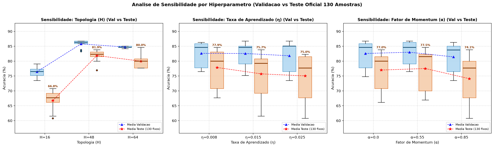

### 1.2 Sensibilidade da Proporção de Validação (`VAL_RATIO`: `10%`, `20%`, `30%`)
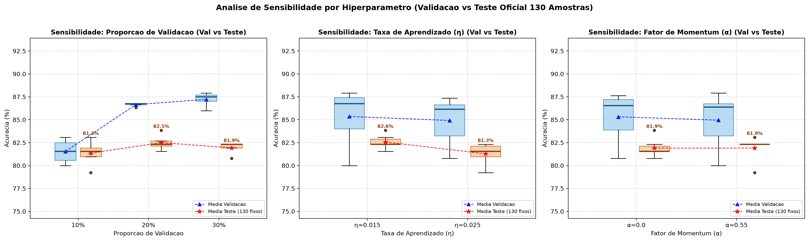

### 1.3 Refinamento com `PATIENCE=5` e `VAL_RATIO=0.30` (Salto para **85,38%**)
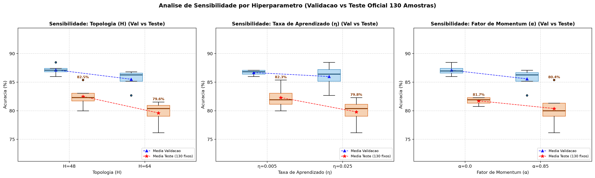

### 1.4 Interação Taxa de Aprendizado ($\eta$) $\times$ Momentum ($\mu$)
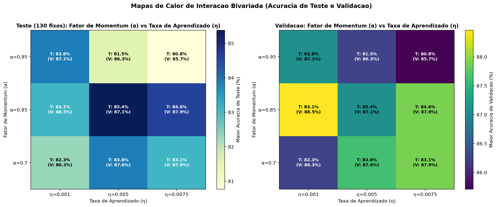

### 1.5 Zoom Fino no Platô Campeão (`LR ∈ {0.004, 0.005, 0.006}` $\times$ `M ∈ {0.825, 0.85, 0.875}`)
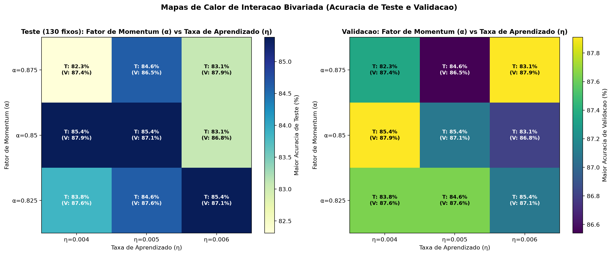

---

## 2. `slide_09_dinamica_e_custo/` (Para o Slide 9)

Relação entre topologia ($H$), taxa de aprendizado ($\eta$), momentum ($\mu$), épocas e tempo (em `Intel Core i5-14600KF | 32GB DDR5`):

| Arquivo | O que mostra / Como usar no Slide 9 |
| :--- | :--- |
| `1_custo_computacional_H16_H48_H64.png` | Gráfico de bolhas (Tempo vs Acurácia de Teste vs Épocas) comparando $H=16$ (`0,31s/ép`), $H=48$ (`0,79–0,88s/ép`) e $H=64$ (`1,05–1,17s/ép`). |
| `2_custo_e_funil_campeao_85.4pct.png` | Fronteira MSE, Funil `Treino → Val → Teste` e custo do campeão (**27 épocas em 21,5s**). |

### 2.1 Custo Computacional e Funil (`H=16` vs `H=48` vs `H=64`)
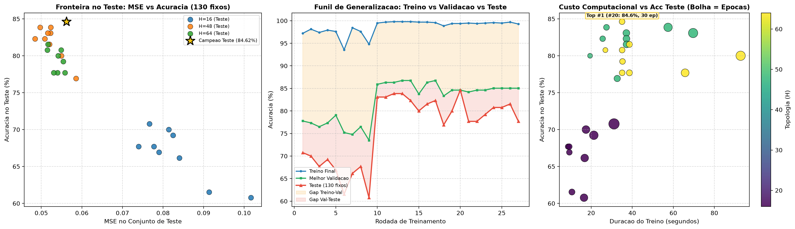

### 2.2 Fronteira MSE, Funil `Treino → Val → Teste` e Custo do Campeão (**27 épocas em 21,5s**)
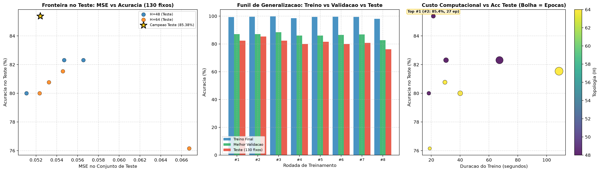

---

## 3. `slide_10_e_11_parada_antecipada_curvas/` (Para os Slides 10 e 11)

Curvas de evolução do **MSE e Acurácia por época** (linha verde = `Melhor Época` de menor MSE de validação; estrela vermelha `★` = resultado nos 130 dados fixos de teste):

| Arquivo | Cenário | Resultado no Teste | Como usar nos Slides 10 e 11 |
| :--- | :--- | :--- | :--- |
| `1_curva_campeao_momentum_com_es_85.4pct.png` | **Campeão Oficial (`M=0.85, P=5`)** | **85,38%** (`21,6s`, 27 ép.) | Curva principal de parada antecipada ideal (parou na época 27, melhor época 22). |
| `2_curva_gd_puro_com_es_83.8pct.png` | **GD Puro (`M=0.00, P=10`)** | **83,85%** (`95,0s`, 119 ép.) | Comparativo sem momentum: mostra a descida lenta que exige **4,4x mais épocas e tempo**. |
| `3_curva_sem_estratificacao_80.8pct.png` | **Sem Estratificação (`STRATIFIED=false`)** | **80,77%** (`-4,61 pp`) | **Ambiente Dificultado 1 (Slide 10):** desbalanceamento de classes na validação prejudica o corte. |
| `4_curva_com_ruido_15pct_76.9pct.png` | **Com Ruído 15% (`NOISE_RATE=0.15`)** | **76,92%** (`-8,46 pp`) | **Ambiente Dificultado 2 (Slide 10):** inversão de 15% dos pixels em treino/validação desloca o limiar de generalização. |
| `5_curva_sem_parada_antecipada_80ep_80.0pct.png` | **Sem Parada Antecipada (`80 épocas`)** | **80,00%** (`-5,38 pp`) | **Contraste Obrigatório (Slide 11):** treino vai a `99,16%`, mas teste cai de `85,38%` para `80,00%` por *overfitting*. |

### 3.1 Campeão Oficial (`M=0.85, P=5, Estratificado`) — **85,38% no Teste** (27 épocas / `21,6s`)
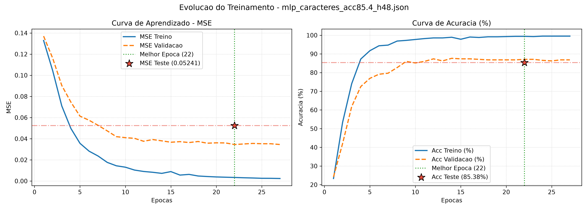

### 3.2 Gradiente Descendente Puro (`M=0.00, P=10, Estratificado`) — **83,85% no Teste** (119 épocas / `95,0s` — 4,4x mais lento)
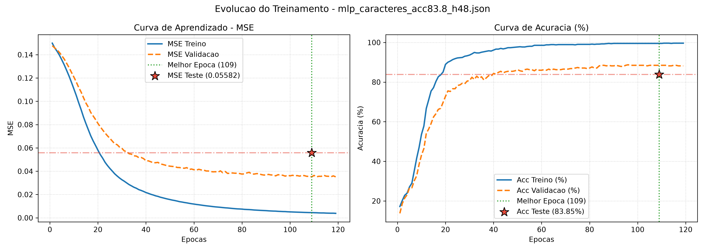

### 3.3 Ambiente Dificultado 1: Sem Estratificação (`STRATIFIED=false`) — **80,77% no Teste (`-4,61 pp`)**
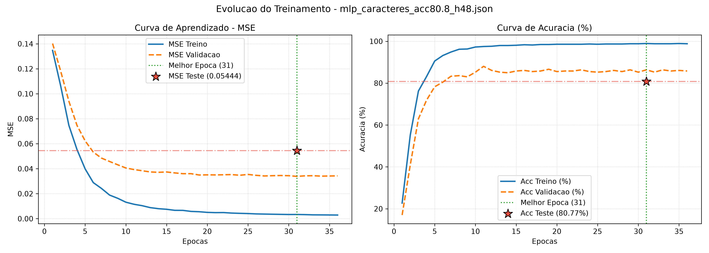

### 3.4 Ambiente Dificultado 2: Com Ruído Bipolar de 15% (`NOISE_RATE=0.15`) — **76,92% no Teste (`-8,46 pp`)**
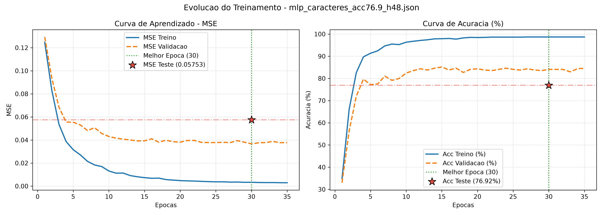

### 3.5 Sem Parada Antecipada (`VAL_RATIO=0.0`, 80 épocas fixas) — **80,00% no Teste (`-5,38 pp` por Overfitting)**
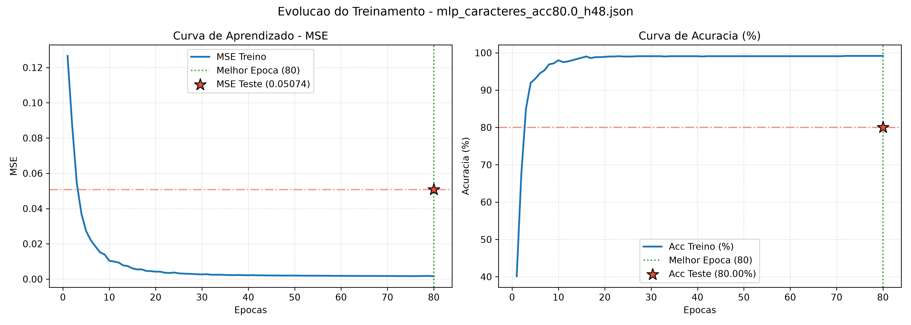

---

## 4. `slide_12_matrizes_de_confusao/` (Para o Slide 12)

Matrizes de confusão nos **130 exemplos fixos de teste** e relatórios com o top confusões:

| Arquivo | O que mostra / Como usar no Slide 12 |
| :--- | :--- |
| `1_matriz_campeao_com_es_85.4pct.png` | **Matriz Principal (Com Parada Antecipada):** `111/130` acertos (**85,38%**). 100% em `Z, Y, V, T, S`; erros restritos a letras parecidas (`A/B → R`, `H → M`, `I → J`). |
| `2_matriz_sem_parada_antecipada_80.0pct.png` | **Matriz Comparativa (Sem Parada Antecipada - 80 ép.):** `104/130` acertos (**80,00%**). Mostra os 7 erros extras gerados pela saturação dos pesos. |
| `3_matriz_gd_puro_com_es_83.8pct.png` | **Matriz GD Puro (`M=0.00`):** `109/130` acertos (**83,85%**). |
| `4_matriz_sem_estratificacao_80.8pct.png` / `5_matriz_com_ruido_15pct_76.9pct.png` | Matrizes opcionais dos cenários dificultados (`105/130` e `100/130`). |
| `1_relatorio_...txt` a `3_relatorio_...txt` | Resumo em texto com acurácia por letra e top 5 confusões de cada matriz para citar na fala. |

### 4.1 Campeão Com Parada Antecipada (`85,38%` — 111/130 acertos)
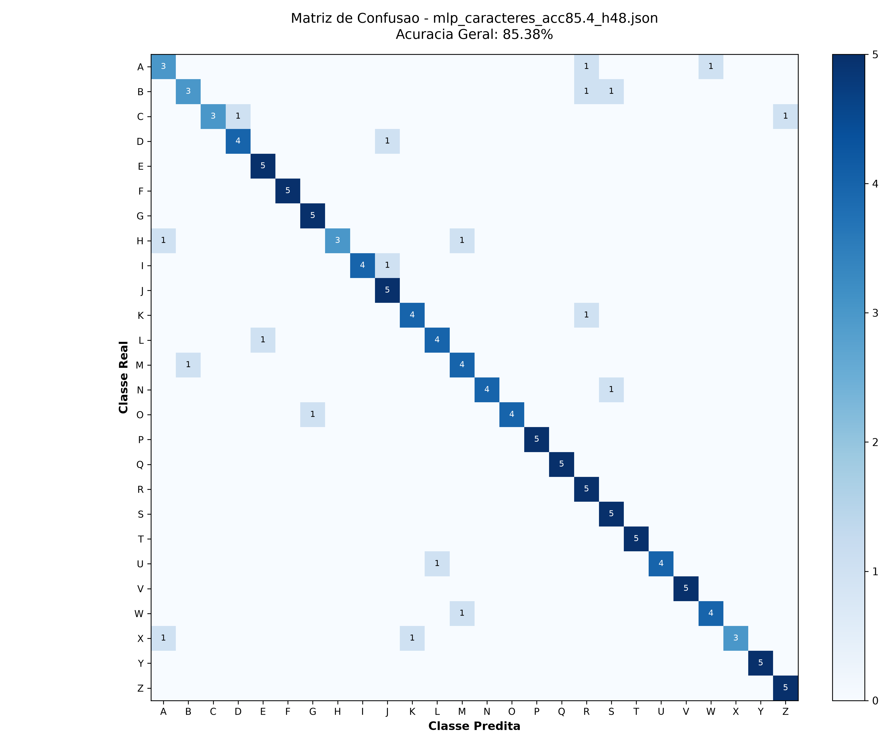

### 4.2 Sem Parada Antecipada — 80 épocas (`80,00%` — 104/130 acertos, `-5,38 pp`)
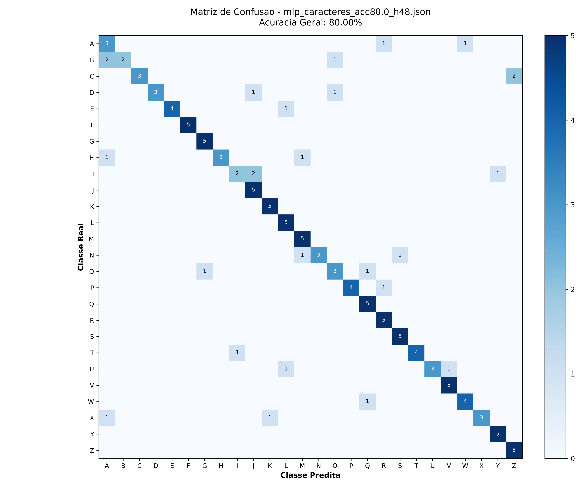

### 4.3 Gradiente Descendente Puro Sem Momentum (`83,85%` — 109/130 acertos)
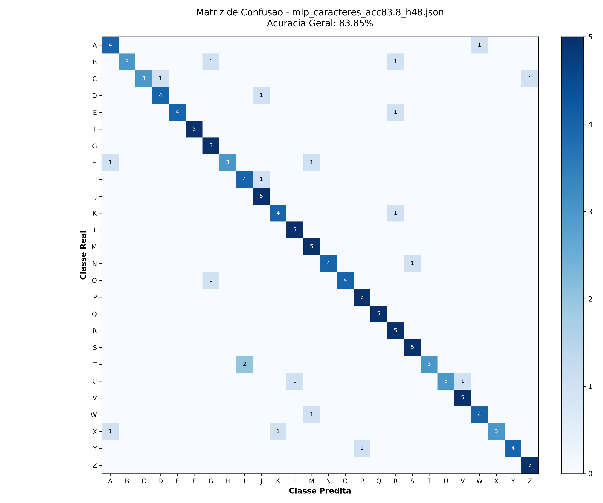

### 4.4 Sem Estratificação (`80,77%`) e Com Ruído 15% (`76,92%`)
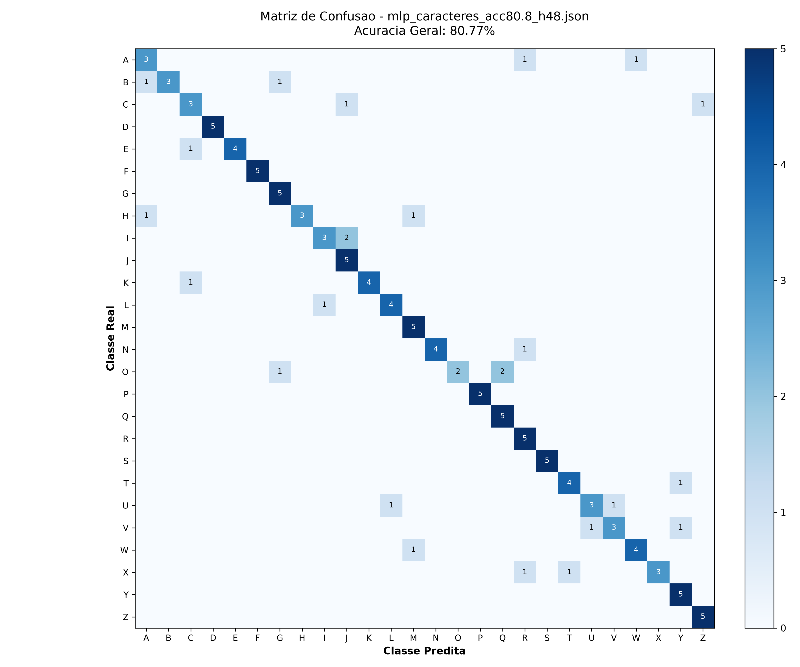

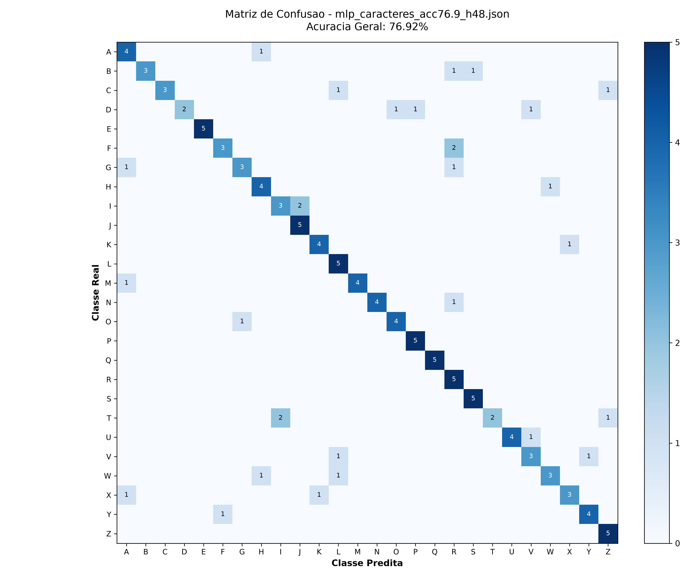

---

## 5. `saidas_oficiais_edisciplinas/` (Arquivos Obrigatórios da Entrega)

Uma subpasta para cada um dos 5 modelos finais acima, já com o `.json` e os **5 arquivos exigidos na especificação**:
1. `hiperparametros.txt` (arquitetura, inicialização, divisão treino/val/teste e métricas)
2. `pesos_iniciais.csv` (`+ _V.csv, _W.csv`)
3. `pesos_finais.csv` (`+ _V.csv, _W.csv`)
4. `historico_erro_treinamento.csv` (MSE por época)
5. `saidas_teste_continuas.csv` e `saidas_teste_discretas.csv` (saídas para os 130 exemplos de teste)
