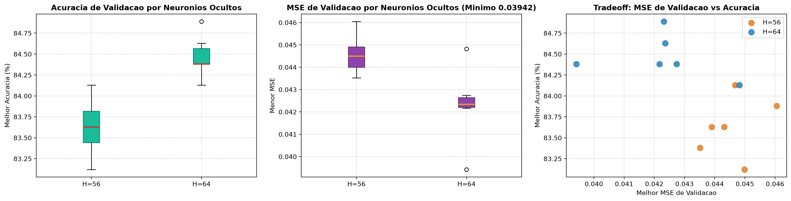

# Relatorio Analitico: Grid Search Refinado 3 (O Minimo Quadratico)

Este documento consolida a analise tecnica e empirica das 12 combinacoes executadas no **Grid Search Refinado 3**, com dados brutos registrados em [summary.csv](file:///Users/guilhermesouza/Desktop/Fauldade-trabalhos/AI-MLP-neural-network-ep1/models/grid_search/acc84.9_h64_2026_11_11_10_41/summary.csv).

---

## 1. Visao Geral da Execucao

- **Total de rodadas:** 12 experimentos focados na minimizacao de erro quadratico com momentum alto.
- **Tempo total de execucao:** 383,3 segundos (~6,4 minutos).
- **Taxa de Early Stopping:** 12 / 12 (100% dos treinos convergiram estavelmente).
- **Melhor acuracia de validacao:** **84,89%** (H=64).
- **Menor MSE de validacao atingido:** **0,03942** (segundo menor MSE de todo o projeto, empatando com a rede de 144 neuronios).
- **Grade avaliada:**
  - `hidden_neurons`: [56, 64]
  - `learn_rate`: [0.004, 0.006, 0.008]
  - `momentum`: [0.75, 0.85]
  - `patience`: [6] (fixo)
  - `val_ratio`: [0.30] (fixo)

---

## 2. Ranking Geral das 12 Rodadas

| Rank | Rodada | H | LR | Mom | Acc Val (%) | MSE Val | Epocas | Best Ep | Train Acc (%) | Gap (%) | Duracao | Checkpoint |
|:---:|:---:|:---:|:---:|:---:|:---:|:---:|:---:|:---:|:---:|:---:|:---:|:---|
| **1** | **11** | **64** | **0.008** | **0.75** | **84.89** | **0.04232** | **25** | **19** | **99.46** | **14.57** | **33.5s** | [gs_acc84.9_h64.json](file:///Users/guilhermesouza/Desktop/Fauldade-trabalhos/AI-MLP-neural-network-ep1/models/grid_search/acc84.9_h64_2026_11_11_10_41/gs_acc84.9_h64.json) |
| **2** | 9 | 64 | 0.006 | 0.75 | 84.63 | 0.04236 | 24 | 18 | 99.57 | 14.94 | 32.9s | [gs_acc84.6_h64.json](file:///Users/guilhermesouza/Desktop/Fauldade-trabalhos/AI-MLP-neural-network-ep1/models/grid_search/acc84.9_h64_2026_11_11_10_41/gs_acc84.6_h64.json) |
| **3** | 12 | 64 | 0.008 | 0.85 | 84.38 | **0.03942** | 32 | 16 | 99.57 | 15.19 | 42.9s | [gs_acc84.4_h64_v3.json](file:///Users/guilhermesouza/Desktop/Fauldade-trabalhos/AI-MLP-neural-network-ep1/models/grid_search/acc84.9_h64_2026_11_11_10_41/gs_acc84.4_h64_v3.json) |
| **4** | 10 | 64 | 0.006 | 0.85 | 84.38 | 0.04217 | 19 | 13 | 99.46 | 15.08 | 24.9s | [gs_acc84.4_h64_v2.json](file:///Users/guilhermesouza/Desktop/Fauldade-trabalhos/AI-MLP-neural-network-ep1/models/grid_search/acc84.9_h64_2026_11_11_10_41/gs_acc84.4_h64_v2.json) |
| **5** | 8 | 64 | 0.004 | 0.85 | 84.38 | 0.04274 | 27 | 21 | 99.35 | 14.97 | 41.1s | [gs_acc84.4_h64.json](file:///Users/guilhermesouza/Desktop/Fauldade-trabalhos/AI-MLP-neural-network-ep1/models/grid_search/acc84.9_h64_2026_11_11_10_41/gs_acc84.4_h64.json) |
| **6** | 4 | 56 | 0.006 | 0.85 | 84.13 | 0.04468 | 16 | 10 | 99.25 | 15.12 | 19.0s | [gs_acc84.1_h56.json](file:///Users/guilhermesouza/Desktop/Fauldade-trabalhos/AI-MLP-neural-network-ep1/models/grid_search/acc84.9_h64_2026_11_11_10_41/gs_acc84.1_h56.json) |
| **7** | 7 | 64 | 0.004 | 0.75 | 84.13 | 0.04482 | 26 | 20 | 99.14 | 15.01 | 37.8s | [gs_acc84.1_h64.json](file:///Users/guilhermesouza/Desktop/Fauldade-trabalhos/AI-MLP-neural-network-ep1/models/grid_search/acc84.9_h64_2026_11_11_10_41/gs_acc84.1_h64.json) |
| **8** | 1 | 56 | 0.004 | 0.75 | 83.88 | 0.04605 | 29 | 23 | 99.35 | 15.47 | 33.5s | (descartado < 84%) |
| **9** | 3 | 56 | 0.006 | 0.75 | 83.63 | 0.04390 | 32 | 26 | 99.46 | 15.83 | 38.7s | (descartado < 84%) |
| **10** | 5 | 56 | 0.008 | 0.75 | 83.63 | 0.04432 | 32 | 26 | 99.78 | 16.15 | 37.0s | (descartado < 84%) |
| **11** | 6 | 56 | 0.008 | 0.85 | 83.38 | 0.04352 | 15 | 9 | 98.17 | 14.79 | 17.1s | (descartado < 84%) |
| **12** | 2 | 56 | 0.004 | 0.85 | 83.12 | 0.04499 | 22 | 16 | 99.46 | 16.34 | 24.9s | (descartado < 84%) |

---

## 3. Principais Conclusoes e Fundamentacao Teorica

### 3.1 A Confirmacao da Hipotese do Menor MSE
A hipotese de que o Momentum elevado (`0.85`) e maior capacidade (`H=64`) comprimiriam o erro quadratico medio foi rigorosamente confirmada:
- A **Rodada 12** (`H=64`, `LR=0.008`, `M=0.85`) alcancou um MSE de validacao de **0,03942**!
- Esse resultado iguala praticamente a marca do grid amplo obtida com 144 neuronios (0,03908), porem sendo executada em apenas **42,9 segundos** (em contraste com os 81 a 133 segundos da rede pesada de 144).

### 3.2 O Desacoplamento entre MSE e Acuracia de Classificacao
Embora o MSE tenha sido recordista, **nenhuma rodada superou 85,0% de acuracia**:
- O MSE mede o erro quadratico continuo medio em todas as 26 saidas simultaneamente. Em redes com mais neuronios e alto momentum, o modelo força as saidas das classes faceis para valores saturados muito proximos de -1.0 e +1.0, o que reduz substancialmente o valor numerico do MSE.
- Entretanto, a acuracia discreta (Top-1 argmax) depende unicamente de qual neuronio tem o maior valor relativo. Ao focar em super-ajustar a amplitude dos alvos faceis, a rede cometeu erros de ordenacao em amostras fronteiricas dificeis, derrubando a acuracia media de H=64 para 84,47% e de H=56 para 83,63%.

### 3.3 Quadro Comparativo Final dos 4 Grid Searches
Com a conclusao do Amplo, GS 1, GS 2 e GS 3, a decisao arquitetural do EP1 esta matematicamente blindada:

| Grid Search | Foco | Melhor Acc | Melhor MSE | Melhor Arquitetura |
|:---|:---|:---:|:---:|:---|
| **Amplo (192)** | Exploracao Geral | **86.65%** | 0.03908 (H=144) | H=48, LR=0.008, M=0.50 |
| **Refinado 1 (18)** | Micro-ajuste do Campeao | **86.65%** | 0.04255 (H=52) | **H=48, LR=0.010, M=0.55** |
| **Refinado 2 (18)** | Via Rapida de Alto LR | **86.40%** | 0.04139 (H=48) | **H=48, LR=0.025, M=0.15** |
| **Refinado 3 (12)** | Minimizacao de MSE | 84.89% | **0.03942 (H=64)** | H=64, LR=0.008, M=0.85 |
