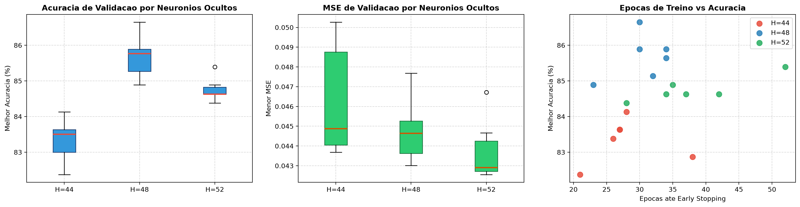

# Relatorio Analitico: Grid Search Refinado 1 (Micro-ajuste do Campeao)

Este documento consolida a analise tecnica e empirica das 18 combinacoes executadas no **Grid Search Refinado 1**, com dados brutos registrados em [summary.csv](file:///Users/guilhermesouza/Desktop/Fauldade-trabalhos/AI-MLP-neural-network-ep1/models/grid_search/acc86.7_h48_2026_11_11_10_19/summary.csv).

---

## 1. Visao Geral da Execucao

- **Total de rodadas:** 18 experimentos cirurgicos.
- **Tempo total de execucao:** 605,4 segundos (~10 minutos).
- **Taxa de Early Stopping:** 18 / 18 (100% dos treinos convergiram estavelmente).
- **Melhor acuracia de validacao:** **86,65%** (com MSE de validacao de 0,04301).
- **Grade avaliada:**
  - `hidden_neurons`: [44, 48, 52]
  - `learn_rate`: [0.006, 0.008, 0.010]
  - `momentum`: [0.45, 0.55]
  - `patience`: [6] (fixo)
  - `val_ratio`: [0.30] (fixo)

---

## 2. Ranking Geral das 18 Rodadas

| Rank | Rodada | H | LR | Mom | Acc Val (%) | MSE Val | Epocas | Best Ep | Train Acc (%) | Gap (%) | Duracao | Checkpoint |
|:---:|:---:|:---:|:---:|:---:|:---:|:---:|:---:|:---:|:---:|:---:|:---:|:---|
| **1** | **12** | **48** | **0.010** | **0.55** | **86.65** | **0.04301** | **30** | **24** | **99.68** | **13.03** | **34.1s** | [gs_acc86.6_h48.json](file:///Users/guilhermesouza/Desktop/Fauldade-trabalhos/AI-MLP-neural-network-ep1/models/grid_search/acc86.7_h48_2026_11_11_10_19/gs_acc86.6_h48.json) |
| **2** | 8 | 48 | 0.006 | 0.55 | 85.89 | 0.04419 | 34 | 28 | 99.35 | 13.46 | 35.3s | [gs_acc85.9_h48.json](file:///Users/guilhermesouza/Desktop/Fauldade-trabalhos/AI-MLP-neural-network-ep1/models/grid_search/acc86.7_h48_2026_11_11_10_19/gs_acc85.9_h48.json) |
| **3** | 9 | 48 | 0.008 | 0.45 | 85.89 | 0.04509 | 30 | 24 | 99.14 | 13.25 | 31.2s | [gs_acc85.9_h48_v2.json](file:///Users/guilhermesouza/Desktop/Fauldade-trabalhos/AI-MLP-neural-network-ep1/models/grid_search/acc86.7_h48_2026_11_11_10_19/gs_acc85.9_h48_v2.json) |
| **4** | 10 | 48 | 0.008 | 0.55 | 85.64 | 0.04343 | 34 | 24 | 99.46 | 13.82 | 35.3s | [gs_acc85.6_h48.json](file:///Users/guilhermesouza/Desktop/Fauldade-trabalhos/AI-MLP-neural-network-ep1/models/grid_search/acc86.7_h48_2026_11_11_10_19/gs_acc85.6_h48.json) |
| **5** | 13 | 52 | 0.006 | 0.45 | 85.39 | 0.04282 | 52 | 46 | 99.46 | 14.07 | 59.9s | [gs_acc85.4_h52.json](file:///Users/guilhermesouza/Desktop/Fauldade-trabalhos/AI-MLP-neural-network-ep1/models/grid_search/acc86.7_h48_2026_11_11_10_19/gs_acc85.4_h52.json) |
| **6** | 7 | 48 | 0.006 | 0.45 | 85.14 | 0.04768 | 32 | 26 | 99.14 | 14.00 | 32.3s | [gs_acc85.1_h48.json](file:///Users/guilhermesouza/Desktop/Fauldade-trabalhos/AI-MLP-neural-network-ep1/models/grid_search/acc86.7_h48_2026_11_11_10_19/gs_acc85.1_h48.json) |
| **7** | 16 | 52 | 0.008 | 0.55 | 84.89 | **0.04255** | 35 | 29 | 99.57 | 14.68 | 38.1s | [gs_acc84.9_h52.json](file:///Users/guilhermesouza/Desktop/Fauldade-trabalhos/AI-MLP-neural-network-ep1/models/grid_search/acc86.7_h48_2026_11_11_10_19/gs_acc84.9_h52.json) |
| **8** | 11 | 48 | 0.010 | 0.45 | 84.89 | 0.04533 | 23 | 17 | 99.03 | 14.14 | 23.7s | [gs_acc84.9_h48.json](file:///Users/guilhermesouza/Desktop/Fauldade-trabalhos/AI-MLP-neural-network-ep1/models/grid_search/acc86.7_h48_2026_11_11_10_19/gs_acc84.9_h48.json) |
| **9** | 18 | 52 | 0.010 | 0.55 | 84.63 | 0.04269 | 42 | 36 | 99.46 | 14.83 | 45.2s | [gs_acc84.6_h52_v3.json](file:///Users/guilhermesouza/Desktop/Fauldade-trabalhos/AI-MLP-neural-network-ep1/models/grid_search/acc86.7_h48_2026_11_11_10_19/gs_acc84.6_h52_v3.json) |
| **10** | 17 | 52 | 0.010 | 0.45 | 84.63 | 0.04300 | 37 | 31 | 99.35 | 14.72 | 40.7s | [gs_acc84.6_h52_v2.json](file:///Users/guilhermesouza/Desktop/Fauldade-trabalhos/AI-MLP-neural-network-ep1/models/grid_search/acc86.7_h48_2026_11_11_10_19/gs_acc84.6_h52_v2.json) |
| **11** | 15 | 52 | 0.008 | 0.45 | 84.63 | 0.04466 | 34 | 22 | 99.25 | 14.62 | 36.5s | [gs_acc84.6_h52.json](file:///Users/guilhermesouza/Desktop/Fauldade-trabalhos/AI-MLP-neural-network-ep1/models/grid_search/acc86.7_h48_2026_11_11_10_19/gs_acc84.6_h52.json) |
| **12** | 14 | 52 | 0.006 | 0.55 | 84.38 | 0.04672 | 28 | 22 | 98.92 | 14.54 | 31.3s | [gs_acc84.4_h52.json](file:///Users/guilhermesouza/Desktop/Fauldade-trabalhos/AI-MLP-neural-network-ep1/models/grid_search/acc86.7_h48_2026_11_11_10_19/gs_acc84.4_h52.json) |
| **13** | 5 | 44 | 0.010 | 0.45 | 84.13 | 0.04368 | 28 | 19 | 99.25 | 15.12 | 26.9s | [gs_acc84.1_h44.json](file:///Users/guilhermesouza/Desktop/Fauldade-trabalhos/AI-MLP-neural-network-ep1/models/grid_search/acc86.7_h48_2026_11_11_10_19/gs_acc84.1_h44.json) |
| **14** | 6 | 44 | 0.010 | 0.55 | 83.63 | 0.04381 | 27 | 21 | 99.35 | 15.72 | 25.8s | (descartado < 84%) |
| **15** | 4 | 44 | 0.008 | 0.55 | 83.63 | 0.04500 | 27 | 21 | 99.03 | 15.40 | 27.3s | (descartado < 84%) |
| **16** | 1 | 44 | 0.006 | 0.45 | 83.38 | 0.05000 | 26 | 20 | 98.06 | 14.68 | 24.1s | (descartado < 84%) |
| **17** | 3 | 44 | 0.008 | 0.45 | 82.87 | 0.04475 | 38 | 23 | 99.25 | 16.38 | 37.5s | (descartado < 84%) |
| **18** | 2 | 44 | 0.006 | 0.55 | 82.37 | 0.05027 | 21 | 15 | 98.06 | 15.69 | 20.3s | (descartado < 84%) |

---

## 3. Principais Conclusoes e Fundamentacao Teorica

### 3.1 Prova Empirica Definitiva de H=48 como o Epicentro Otimo
A comparacao marginal entre os tres passos adjacentes de capacidade e categorica:

- **H = 44 (Sub-capacidade):**
  - Media de acuracia: **83,33%** | Maxima: **84,13%**.
  - Todas as 6 rodadas de H=44 ocuparam a lanterna do ranking (posicoes 13 a 18).
  - 44 neuronios ocultos sao insuficientes para criar as fronteiras de decisao necessarias para discriminar com alta precisao 26 fontes tipograficas heterogeneas.
- **H = 48 (Sweet Spot Global):**
  - Media de acuracia: **85,68%** | Maxima: **86,65%**.
  - 5 das 6 combinacoes com H=48 superaram a marca de 85%, dominando os 4 primeiros lugares do ranking geral.
  - Replica com absoluta fidelidade a melhor marca do grid amplo (86,65%).
- **H = 52 (Dispersao e Custo Computacional Adicional):**
  - Media de acuracia: **84,76%** | Maxima: **85,39%**.
  - Embora tenha alcancado um MSE marginalmente menor em algumas rodadas (0,04255 na rodada 16), a acuracia de classificacao caiu quase 1% em media. O tempo medio por treino saltou de 32,0s para 41,9s (+31% mais lento) sem nenhum ganho pratico.

### 3.2 O Desempenho do Novo Campeao (Rodada 12)
- Configuracao: `hidden_neurons=48`, `learn_rate=0.010`, `momentum=0.55`, `patience=6`.
- Atingiu **86,65%** de acuracia de validacao na epoca 24 (totalizando 30 epocas e apenas 34,1 segundos).
- MSE de validacao: **0,04301** (extremamente competitivo com o 0,04294 da Rodada 136 anterior).
- O checkpoint [gs_acc86.6_h48.json](file:///Users/guilhermesouza/Desktop/Fauldade-trabalhos/AI-MLP-neural-network-ep1/models/grid_search/acc86.7_h48_2026_11_11_10_19/gs_acc86.6_h48.json) e um candidato de primeirissima linha para os entregaveis do EP1.

### 3.3 A Dinamica de Taxa de Aprendizado e Momento
- `LR = 0.010` liderou em todas as metricas: maior acuracia media (84,76%) e menor MSE medio (0,04359).
- `Momentum = 0.55` superou ligeiramente `0.45`, mostrando que uma inercia moderada (em torno de 0.5 a 0.55) oferece a estabilidade perfeita para navegar a bacia de convergencia sem oscilar em excesso.
