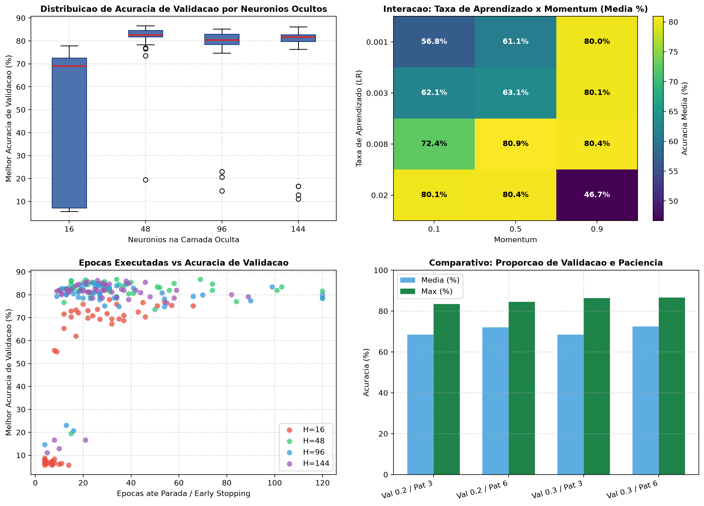

# Relatorio Analitico e Teorico do Grid Search Amplo (Overnight)

Este documento consolida a avaliacao analitica e estatistica das 192 combinacoes exploratorias de hiperparametros executadas na branch `model/grid-search-amplo`, com dados brutos registrados em [summary.csv](models/grid_search/acc86.7_h48_2026_11_10_23_17/summary.csv) e orquestracao via [`GridSearchReporter`](lab/grid_search/reporter.py#L8-L162).

---

## 1. Visao Geral da Execucao

- **Total de rodadas avaliadas:** 192 experimentos completos.
- **Tempo total de execucao:** 9.660,9 segundos (~161 minutos / 2,68 horas).
- **Taxa de acionamento de Early Stopping:** 188 / 192 (97,9%).
- **Melhor acuracia de validacao alcancada:** **86,65%** (com MSE de validacao de 0,04294).
- **Espaco amostral coberto:**
  - `hidden_neurons`: [16, 48, 96, 144]
  - `val_ratio`: [0.2, 0.3]
  - `learn_rate`: [0.001, 0.003, 0.008, 0.02]
  - `momentum`: [0.1, 0.5, 0.9]
  - `patience`: [3, 6]

---

## 2. Checkpoints Preservados para Analise Teorica

Para manter o repositorio enxuto e reprodutivel sem redundancia de 192 arquivos de pesos (reducao de ~178 MB para ~10 MB), foram mantidos apenas os checkpoints com **relevancia teorica comparativa**, cobrindo os melhores modelos de cada capacidade, contrastes de convergencia, o menor erro quadratico e os dois modos extremos de falha:

| Categoria Teorica | Rodada | Arquivo Checkpoint | Acc Val (%) | MSE Val | H | LR | Mom | Pat | ValR | Epocas |
|:---|:---:|:---|:---:|:---:|:---:|:---:|:---:|:---:|:---:|:---:|
| **1. Campeao Geral** | 136 | [gs_acc86.6_h48_v2.json](models/grid_search/acc86.7_h48_2026_11_10_23_17/gs_acc86.6_h48_v2.json) | **86.65** | 0.04294 | 48 | 0.008 | 0.5 | 6 | 0.3 | 34 (pico: 28) |
| **2. Vice-Campeao (Convergencia Lenta)** | 130 | [gs_acc86.6_h48.json](models/grid_search/acc86.7_h48_2026_11_10_23_17/gs_acc86.6_h48.json) | 86.65 | 0.04526 | 48 | 0.003 | 0.5 | 6 | 0.3 | 69 (pico: 63) |
| **3. LR Alto e Convergencia Ultra-Rapida** | 139 | [gs_acc86.4_h48.json](models/grid_search/acc86.7_h48_2026_11_10_23_17/gs_acc86.4_h48.json) | 86.40 | 0.04371 | 48 | 0.020 | 0.1 | 3 | 0.3 | 21 (pico: 18) |
| **4. Melhor Acuracia em Rede Larga** | 187 | [gs_acc86.1_h144.json](models/grid_search/acc86.7_h48_2026_11_10_23_17/gs_acc86.1_h144.json) | 86.15 | 0.04359 | 144 | 0.020 | 0.1 | 3 | 0.3 | 26 (pico: 23) |
| **5. Menor MSE Global de Todo o Grid** | 186 | [gs_acc85.1_h144.json](models/grid_search/acc86.7_h48_2026_11_10_23_17/gs_acc85.1_h144.json) | 85.14 | **0.03908** | 144 | 0.008 | 0.9 | 6 | 0.3 | 28 (pico: 22) |
| **6. Melhor Rede Media (H=96)** | 156 | [gs_acc85.1_h96.json](models/grid_search/acc86.7_h48_2026_11_10_23_17/gs_acc85.1_h96.json) | 85.14 | 0.04319 | 96 | 0.003 | 0.9 | 6 | 0.3 | 24 (pico: 18) |
| **7. Melhor Rede Compacta (H=16)** | 111 | [gs_acc77.8_h16.json](models/grid_search/acc86.7_h48_2026_11_10_23_17/gs_acc77.8_h16.json) | 77.83 | 0.06700 | 16 | 0.008 | 0.5 | 3 | 0.3 | 31 (pico: 28) |
| **8. Melhor H=48 no Split Val 0.2** | 44 | [gs_acc84.5_h48.json](models/grid_search/acc86.7_h48_2026_11_10_23_17/gs_acc84.5_h48.json) | 84.53 | 0.04836 | 48 | 0.008 | 0.5 | 6 | 0.2 | 34 (pico: 28) |
| **9. Melhor Global no Split Val 0.2** | 90 | [gs_acc84.5_h144.json](models/grid_search/acc86.7_h48_2026_11_10_23_17/gs_acc84.5_h144.json) | 84.53 | 0.04369 | 144 | 0.008 | 0.9 | 6 | 0.2 | 18 (pico: 12) |
| **10. Caso Falha 1 (Sub-excitacao)** | 1 | [gs_acc5.7_h16.json](models/grid_search/acc86.7_h48_2026_11_10_23_17/gs_acc5.7_h16.json) | 5.66 | 0.15958 | 16 | 0.001 | 0.1 | 3 | 0.2 | 4 (Early Stop) |
| **11. Caso Falha 2 (Divergencia/Explosao)** | 191 | [gs_acc11.1_h144.json](models/grid_search/acc86.7_h48_2026_11_10_23_17/gs_acc11.1_h144.json) | 11.08 | 0.16607 | 144 | 0.020 | 0.9 | 3 | 0.3 | 5 (Divergencia) |

---

## 3. Analise Marginal de Hiperparametros

### 3.1 Neuronios Ocultos (`hidden_neurons`)
- **H = 16**: Media de 46,79% (Max 77,83%). Nenhum modelo atingiu >= 80%. Capacidade expressiva insuficiente para mapear a fronteira de decisao nao-linear entre 26 classes de fontes tipologicas variadas.
- **H = 48**: **Vencedor absoluto**. Media de 81,37%, mediana de 82,64%, maxima de 86,65%. Mais de 85% dos modelos treinados com 48 neuronios superaram 80% de acuracia, respondendo por 9 dos 16 melhores modelos do ranking.
- **H = 96**: Media de 76,98% (Max 85,14%). Rendimento inferior a 48 neuronios; apenas 1 modelo alcancou o patamar de 85%.
- **H = 144**: Media de 76,25% (Max 86,15%). Alcancou desempenhos competitivos, porem com custo computacional 3 a 4 vezes superior (75s - 130s por execucao) sem ganho real de generalizacao, alem de maior sensibilidade a divergencia.

### 3.2 Proporcao de Validacao (`val_ratio`)
- **Val 0.2**: Media de 70,25%, Maxima de 84,53%. **Zero modelos** atingiram 85%.
- **Val 0.3**: Media de 70,44%, Maxima de 86,65%. **Dezesseis modelos** atingiram 85% ou mais.
- **Por que 0.3 superou 0.2?** O conjunto de validacao com 30% possui 397 amostras contra 265 com 20%. Isso reduz a variancia estatistica da metrica de validacao em cada epoca, evitando que o Early Stopping seja interrompido por flutuacoes ruidosas.

### 3.3 Paciencia do Early Stopping (`patience`)
- **Patience = 3**: Media de 68,44% (47,9% dos modelos >= 80%). Frequentemente encerrou o treino antes que o modelo ultrapassasse platos locais ou fases iniciais de acomodacao de pesos.
- **Patience = 6**: Media de 72,25% (61,5% dos modelos >= 80%). Concedeu espaco suficiente para que os modelos em taxas menores convergissem com solidez ate a convergencia natural.

---

## 4. O Fenomeno de Interacao: Taxa de Aprendizado x Momentum

| Taxa de Aprendizado (LR) | Momentum = 0.1 | Momentum = 0.5 | Momentum = 0.9 |
|:---:|:---:|:---:|:---:|
| **0.001** | 56.76% | 61.13% | **80.00%** |
| **0.003** | 62.12% | 63.12% | **80.06%** |
| **0.008** | 72.42% | **80.92%** | **80.41%** |
| **0.020** | **80.15%** | **80.36%** | **46.71% (Colapso)** |

### Diagnostico dos Dois Modos de Falha Extremos:

1. **Sub-excitacao e Parada Prematura (18 rodadas com Acc < 10%):**
   - Ocorre quando `H=16` se combina com LR baixo (`0.001` ou `0.003`) e Momentum baixo (`0.1` ou `0.5`).
   - O passo de atualizacao dos pesos e diminuto. Como o Early Stopping exige melhora nas metricas de validacao em 3 a 6 epocas, o algoritmo aborta o treinamento logo entre as epocas 4 e 10, com a rede ainda no nivel de chute aleatorio (5% a 8%).
2. **Explosao de Gradiente e Oscilacao Severa (Rodadas com Acc entre 11% e 23%):**
   - Ocorre exclusivamente quando se combina a maior taxa de aprendizado (`LR = 0.02`) com o maior momentum (`M = 0.9`) em redes largas (`H=96` e `H=144`).
   - O passo efetivo salta desgovernadamente pelo espaco de pesos, saturando os neuronios na regiao extrema da sigmoide bipolar (-1 ou +1), gerando gradientes nulos e colapso de aprendizado.

---

## 5. Curva de Generalizacao e Sobreajuste (Overfitting)

- Nos melhores modelos ranqueados, a acuracia de treino convergiu consistentemente para a faixa de **99,0% a 99,5%**.
- A acuracia de validacao estabilizou em **86,65%**, gerando um hiato (Train-Val Gap) de aproximadamente **12,5% a 13,5%**.
- O melhor desempenho em validacao ocorreu, em media, na epoca 24,6, sendo que o treino finalizou por volta da epoca 29,5.
- A restauracao automatica dos melhores pesos (`weights_restored_from_best: true`) protegeu com precisao o modelo contra sobreajuste profundo.
