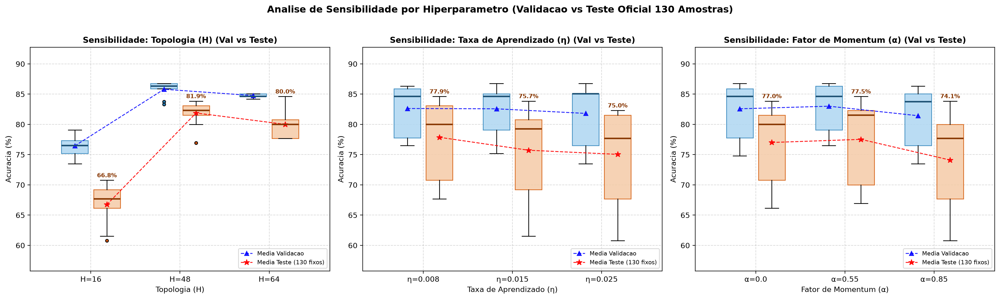
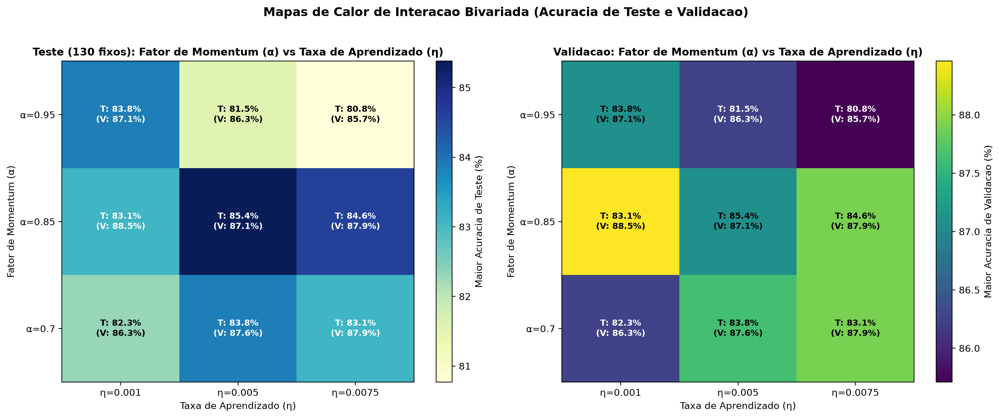
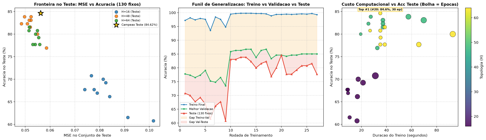
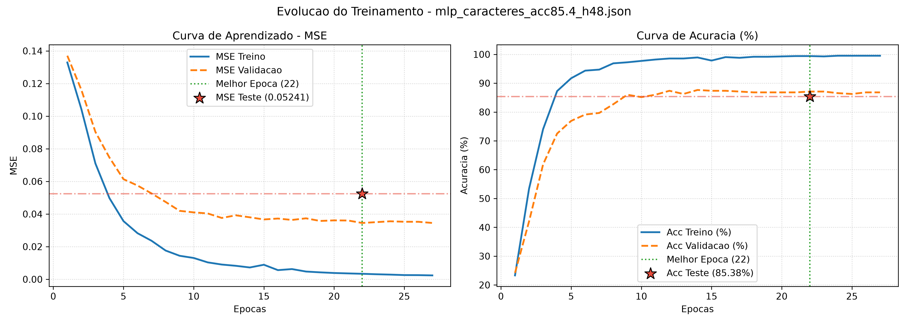
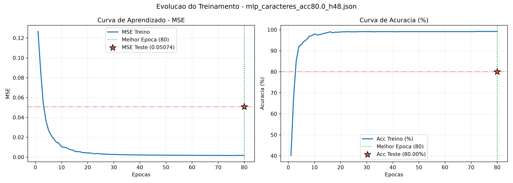
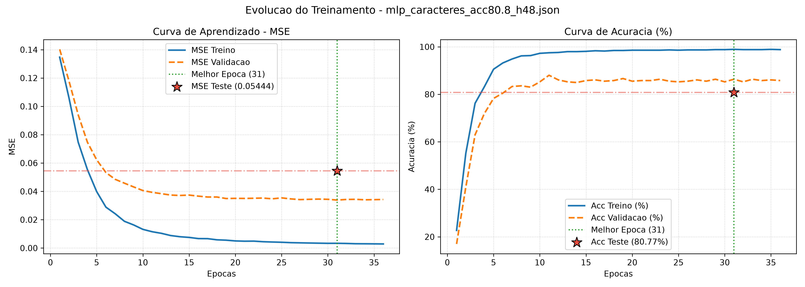
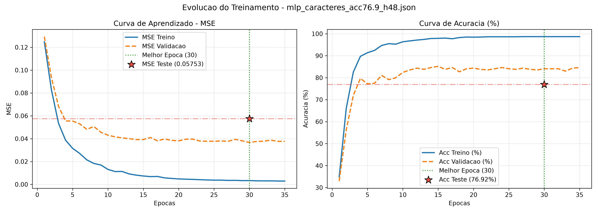
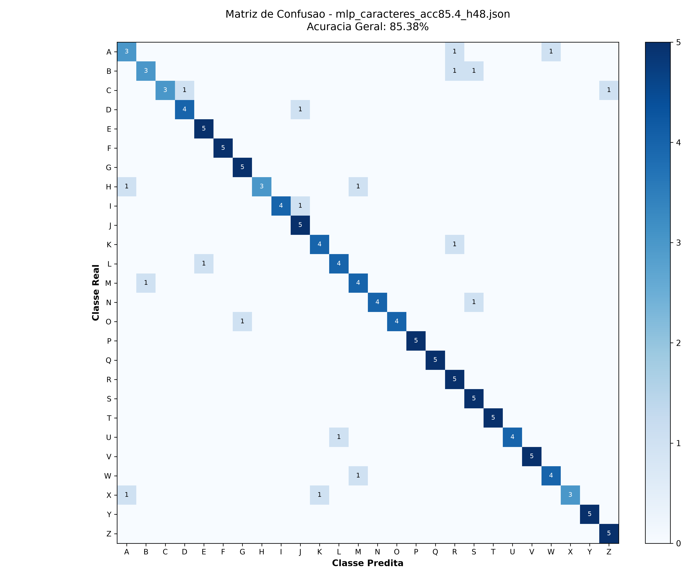
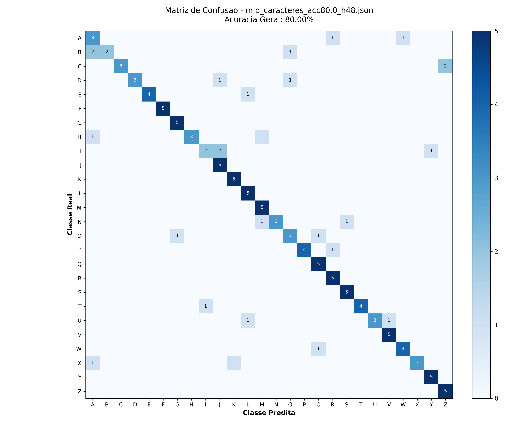
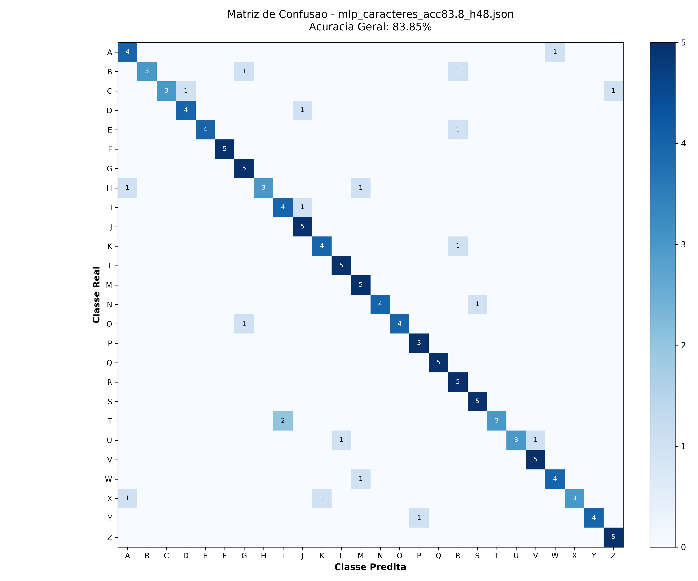

# 3. Guia Mestre Consolidado — Montagem de TODOS os Slides (Tópicos 1 a 14)

> **Integrantes do Grupo (EACH-USP | IA 2026 — Entrega 1: MLP):**
> - **Guilherme Oliveira de Souza** — Nº USP: `14671388`
> - **Paulo Rogerio Andrade de Oliveira** — Nº USP: `9365783`
> - **Victor Hugo Antunes Valadares** — Nº USP: `14760317`

Este documento consolida **em um único lugar** tudo o que vai em cada tópico do `docs/template-slides.pptx` (textos, fórmulas, cards curtos de código **100% fiéis ao `src/` com docstrings e comentários**, tabelas e gráficos embutidos de `artefatos_entrega/`).

> [!TIP]
> **Os 14 slides do template funcionam como um índice de tópicos na ordem obrigatória:** você **não precisa espremer tudo em 14 páginas!** Conforme autorizado pela professora no Slide 12 do template (*"Você pode usar mais slides, entre os tópicos que coloquei ou depois para questões adicionais, mas NÃO altere a ordem de apresentação dos tópicos"*), cada `Card 2A/2B/2C`, `Card 3A/3B/3C/3D` ou par de gráficos pode ocupar um slide próprio mantendo o título do tópico no topo.

---

## Mapa Geral e Divisão Oficial dos 3 Apresentadores

| Bloco | Slides do Template | Tópicos | Apresentador |
| :--- | :---: | :--- | :--- |
| **Parte 1 (Teoria + Código Base)** | **Slides 1 a 5** | Capa, Estruturas de Dados, Feedforward/MSE e Backpropagation ($\delta_k$ e $\delta_j$) | **Paulo Rogerio Andrade de Oliveira (`9365783`)** (~4 a 4,5 min) |
| **Parte 2 (Código Final + Busca + Dinâmica + Parada Antecipada)** | **Slides 6 a 11** | Atualização de Pesos, Reconhecimento (`argmax`), Busca de Parâmetros, Tempo/Hardware, Execução no Terminal e Curvas de Parada Antecipada | **Guilherme Oliveira de Souza (`14671388`)** (~6,5 a 7,5 min) |
| **Parte 3 (Matrizes de Confusão + Extras)** | **Slides 12 a 14** | Matrizes de Confusão (com/sem parada antecipada e variações), Implementações Adicionais e Encerramento | **Victor Hugo Antunes Valadares (`14760317`)** (~3,5 a 4 min) |

---

# PARTE 1 — SLIDES 1 A 5 (Paulo: Estruturas, Feedforward e Backpropagation)

---

## SLIDE 1 — Capa (MLP Implementações)

**Texto no Slide (seguindo o layout laranja do template):**
- `14671388 – Guilherme Oliveira de Souza (APRESENTADOR)`
- `9365783 – Paulo Rogerio Andrade de Oliveira (APRESENTADOR)`
- `14760317 – Victor Hugo Antunes Valadares (APRESENTADOR)`

---

## SLIDE 2 — Estruturas de dados e programação

**Título:** `Estruturas de dados e programação`

**Coluna da Esquerda (Explicação e Relação com o Problema de Caracteres):**
- **Camada de Entrada ($n = 120$ unidades):**
  - Cada caractere do `CARACTERES COMPLETO` (`1.326` amostras = 51 alfabetos de A a Z) é uma grade $12 \times 10$ achatada em `list[float]` de **120 pixels bipolares** ($-1.0$ fundo branco e $+1.0$ traço da letra).
- **Camada Escondida ($p = 48$ neurônios no modelo campeão):**
  - Instância da classe `Layer` (`hidden_layers: list[Layer]`), com potencial $z\_in_j = v_{0j} + \sum_{i=1}^{120} x_i v_{ij}$ e ativação **Sigmoide Bipolar** $z_j \in (-1, +1)$.
- **Camada de Saída ($m = 26$ neurônios):**
  - Instância de `Layer` (`self.output_layer`), codificada em **One-Hot Bipolar** (**+1.0** na letra-alvo entre `'A'..'Z'` e **-1.0** nas outras 25 posições).
- **Matrizes de Pesos e Biases (`list[list[float]]` e `list[float]`):**
  - **Matriz $V$ ($p \times 120$) e bias $v_{0j}$ ($p$):** pesos da camada escondida inicializados uniformemente em $(-0.2, +0.2)$.
  - **Matriz $W$ ($26 \times p$) e bias $w_{0k}$ ($26$):** pesos da camada de saída + acumuladores `last_delta_weights` para o termo de Momentum.

**Coluna da Direita (3 Cards Curtos de Código — 100% Fiéis ao `src/`):**

- **Card 2A — Entrada de 120 Pixels (`src/data/dataset_loader.py`, linhas 54–60):**
```python
# 1. Leitura e sanitização dos pixels de entrada (120 colunas por amostra)
with open(filepath_inputs, "r", encoding="utf-8-sig") as f:
    all_inputs = [
        [float(pixel) for pixel in line.strip().split(",")[:120]]
        for line in f
        if line.strip()
    ]
```

- **Card 2B — Saída de 26 Classes One-Hot Bipolar (`src/data/dataset_loader.py`, linhas 66–76):**
```python
# 3. Mapeamento das 26 classes do alfabeto e codificação One-Hot Bipolar (-1.0 e +1.0)
class_labels = [chr(code) for code in range(ord("A"), ord("Z") + 1)]
label_to_index = {label: index for index, label in enumerate(class_labels)}

all_targets: list[list[float]] = []
for label in all_labels:
    target_vector = [-1.0] * len(class_labels)
    if label in label_to_index:
        target_vector[label_to_index[label]] = 1.0
    all_targets.append(target_vector)
```

- **Card 2C — Camada e Matrizes de Pesos $V$ e $W$ (`src/core/models/layer.py`, linhas 40–59):**
```python
# Inicializa os biases (v_0j ou w_0k) de cada neurônio no intervalo especificado
self.bias: list[float] = list(
    np.random.uniform(low=b_min, high=b_max, size=num_neurons)
)

# Inicializa a matriz de pesos (v_ij ou w_jk) de dimensão (num_neurons x num_inputs)
self.weights: list[list[float]] = [
    list(np.random.uniform(low=w_min, high=w_max, size=num_inputs))
    for _ in range(num_neurons)
]

# Estado em cache da última propagação direta (usado no Backpropagation)
self.last_inputs: list[float] = []
self.last_outputs: list[float] = []

# Acumuladores da variação anterior de pesos (Δv(t-1) ou Δw(t-1)) para o Momentum
self.last_delta_weights: list[list[float]] = [
    [0.0 for _ in range(num_inputs)] for _ in range(num_neurons)
]
self.last_delta_bias: list[float] = [0.0 for _ in range(num_neurons)]
```

---

## SLIDE 3 — Feedforward e cálculo do erro da rede

**Título:** `Feedforward e cálculo do erro da rede`

**Coluna da Esquerda (Explicação Teórica — Passos 3, 4 e 5 de Fausett):**
- **Potencial de Ativação (`Layer.compute_net_input`):**
  - Calcula a combinação linear das entradas somada ao bias:
    $$z\_in_j = v_{0j} + \sum_{i=1}^{n} x_i \cdot v_{ij} \quad \text{e} \quad y\_in_k = w_{0k} + \sum_{j=1}^{p} z_j \cdot w_{jk}$$
- **Propagação por Camada (`Layer.forward`) e Rede (`MLP.predict`):**
  - Aplica a função de ativação $z_j = f(z\_in_j)$ e armazena `self.last_inputs` e `self.last_outputs` em cache para a etapa de retropropagação.
- **Cálculo do Erro Quadrático Médio (`MLP.compute_mse`):**
  - Mede a média dos quadrados dos erros $(t_k - y_k)^2$ em todas as 26 saídas da rede:
    $$\text{MSE} = \frac{1}{N \cdot m} \sum_{p=1}^{N} \sum_{k=1}^{m} (t_k^{(p)} - y_k^{(p)})^2$$

**Coluna da Direita (4 Cards Curtos de Código — 100% Fiéis ao `src/`):**

- **Card 3A — Potencial de Ativação (`src/core/models/layer.py`, linhas 65–73):**
```python
def compute_net_input(self, i_neuron: int, inputs: list[float]) -> float:
    """
    Calcula o potencial de ativação (combinação linear + bias) de um neurônio:
    z_in_j = v_0j + Σ_i (x_i * v_ij)   [ou y_in_k = w_0k + Σ_j (z_j * w_jk)]
    """
    net_in = self.bias[i_neuron]
    for inp, weight in zip(inputs, self.weights[i_neuron]):
        net_in += inp * weight
    return net_in
```

- **Card 3B — Feedforward da Camada (`src/core/models/layer.py`, linhas 75–96):**
```python
def forward(self, inputs: list[float]) -> list[float]:
    """
    Executa a fase de Feedforward da camada:
    Para cada neurônio, calcula o somatório ponderado (net_in) e aplica a ativação f(net_in).
    """
    # Armazena as entradas (x_i ou z_j) para uso na atualização de pesos do Backpropagation
    self.last_inputs = inputs

    outputs: list[float] = []
    for i_neuron in range(self.num_neurons):
        y_in_neuron = self.compute_net_input(i_neuron, inputs)
        outputs.append(self.activation_func(y_in_neuron))

    # Armazena as saídas ativadas (z_j ou y_k) para o cálculo da derivada f'(net_in)
    self.last_outputs = outputs
    return outputs
```

- **Card 3C — Feedforward da Rede (`src/core/models/mlp.py`, linhas 82–96):**
```python
def predict(self, inputs: list[float]) -> list[float]:
    """
    Executa a fase de Feedforward completa da rede (Passos 3, 4 e 5 de Fausett — Slide 3):
    Propaga o vetor de entrada x pela(s) camada(s) escondida(s) até a camada de saída.
    """
    current_activations = inputs
    for layer in self.hidden_layers:
        current_activations = layer.forward(current_activations)

    return self.output_layer.forward(current_activations)
```

- **Card 3D — Erro Quadrático Médio (`src/core/models/mlp.py`, linhas 118–124):**
```python
@staticmethod
def compute_mse(outputs_arr: np.ndarray, targets_arr: np.ndarray) -> float:
    """
    Calcula o Erro Quadrático Médio (MSE) na saída da rede neural (Slide 3 e Slide 11):
    MSE = média de (t_k - y_k)^2 sobre todas as amostras e neurônios de saída.
    """
    return float(np.mean((targets_arr - outputs_arr) ** 2))
```

---

## SLIDE 4 — Backpropagation – cálculo do erro para retropropagação (Camada de Saída)

**Título:** `Backpropagation – cálculo do erro para retropropagação`

**Coluna da Esquerda (Explicação Teórica — Passo 6 de Fausett):**
- **Termo de Informação de Erro na Saída ($\delta_k$):**
  - Para cada um dos $m = 26$ neurônios da camada de saída, comparamos o alvo esperado $t_k \in \{-1, +1\}$ com a saída obtida $y_k \in (-1, +1)$, ponderando pela derivada da função de ativação:
    $$\delta_k = (t_k - y_k) \cdot f'(y\_in_k)$$
- **Derivada Eficiente em função da Saída Ativada $y_k$:**
  - Para a **Sigmoide Bipolar** $f(x) = \frac{2}{1 + e^{-x}} - 1$, usamos a identidade algébrica que reaproveita diretamente $y_k$ salvo no Feedforward:
    $$f'(y\_in_k) = \frac{1}{2}(1 - y_k)(1 + y_k)$$
  - Validado 100% no Teste de Mesa (`make lab_mesa_test`: $\delta_1 = 0.1253$, $\delta_2 = -0.1285$).

**Coluna da Direita (2 Cards Curtos de Código — 100% Fiéis ao `src/`):**

- **Card 4A — Sigmoide Bipolar e Derivada (`src/core/funcs/sigmoide.py`, linhas 21–33):**
```python
def sigmoide_bipolar(y_in: float) -> float:
    """
    Função de ativação sigmoide logística bipolar / tangente hiperbólica escalada (intervalo [-1, 1]).
    """
    y_in = max(-500.0, min(500.0, y_in))
    return (2 / (1 + math.exp(-1 * y_in))) - 1


def deriv_sigmoide_bipolar(y: float) -> float:
    """
    Derivada da sigmoide bipolar expressa em termos do valor ativado y = f(y_in).
    """
    return 0.5 * (1 - y) * (1 + y)
```

- **Card 4B — Erro Retropropagado na Saída (`src/core/models/layer.py`, linhas 102–113):**
```python
def compute_output_deltas(
    self, target: list[float], outputs: list[float]
) -> list[float]:
    """
    Calcula o termo de informação de erro para a camada de saída (Passo 6 de Fausett — Slide 4):
    δ_k = (t_k - y_k) * f'(y_in_k)
    """
    output_deltas: list[float] = []
    for t_k, y_k in zip(target, outputs):
        delta_k = (t_k - y_k) * self.derivative_activation(y_k)
        output_deltas.append(delta_k)
    return output_deltas
```

---

## SLIDE 5 — Backpropagation – contribuição do erro na camada escondida

**Título:** `Backpropagation – contribuição do erro na camada escondida`

**Coluna da Esquerda (Explicação Teórica — Passo 7 de Fausett):**
- **Como os neurônios ocultos não possuem alvo direto ($t_j$):**
  - O erro de cada neurônio escondido $j \in \{1..p\}$ é obtido pela **Regra da Cadeia**, somando os termos de erro $\delta_k$ da camada de saída ponderados pelos pesos sinápticos $w_{jk}$ que conectam $j$ a cada saída $k$:
    $$\delta\_in_j = \sum_{k=1}^{m} \delta_k \cdot w_{jk}$$
- **Termo de Erro Oculto ($\delta_j$):**
  - Multiplicamos a soma retropropagada $\delta\_in_j$ pela derivada da ativação oculta em relação à saída armazenada `z_j = self.last_outputs[j_neuron]`:
    $$\delta_j = \delta\_in_j \cdot f'(z\_in_j)$$
  - Importante: o cálculo usa `self.output_layer.weights` ($W$) **antes** da atualização de pesos do Passo 8 (no Teste de Mesa: $\delta_j = [0.0063, -0.0032, 0.0063]$).

**Coluna da Direita (2 Cards Curtos de Código — 100% Fiéis ao `src/`):**

- **Card 5A — Contribuição do Erro na Camada (`src/core/models/layer.py`, linhas 115–138):**
```python
def compute_hidden_deltas(
    self,
    next_layer_deltas: list[float],
    next_layer_weights: list[list[float]],
) -> list[float]:
    """
    Calcula a contribuição do erro na camada escondida (Passo 7 de Fausett — Slide 5):
    1. Soma ponderada dos erros da camada seguinte: δ_in_j = Σ_k (δ_k * w_jk)
    2. Multiplicação pela derivada da ativação:     δ_j = δ_in_j * f'(z_in_j)
    """
    hidden_deltas: list[float] = []
    for j_neuron in range(self.num_neurons):
        # δ_in_j = Σ_k (δ_k * w_jk)
        delta_in_j = 0.0
        for k_next, delta_k in enumerate(next_layer_deltas):
            weight_jk = next_layer_weights[k_next][j_neuron]
            delta_in_j += delta_k * weight_jk

        # δ_j = δ_in_j * f'(z_in_j)
        z_j = self.last_outputs[j_neuron]
        delta_j = delta_in_j * self.derivative_activation(z_j)
        hidden_deltas.append(delta_j)

    return hidden_deltas
```

- **Card 5B — Retropropagação com $W$ Intacto (`src/core/models/mlp.py`, linhas 204–225):**
```python
def _compute_hidden_deltas(
    self, output_deltas: list[float]
) -> list[list[float]]:
    """
    Passo 7 de Fausett (Slide 5) — Contribuição do erro na(s) camada(s) escondida(s):
    δ_in_j = Σ_k (δ_k * w_jk)  =>  δ_j = δ_in_j * f'(z_in_j)
    Calculado usando os pesos atuais (antes da atualização do Passo 8).
    """
    hidden_deltas_per_layer: list[list[float]] = []
    next_deltas = output_deltas
    next_weights = self.output_layer.weights

    for layer in reversed(self.hidden_layers):
        current_deltas = layer.compute_hidden_deltas(
            next_layer_deltas=next_deltas,
            next_layer_weights=next_weights,
        )
        hidden_deltas_per_layer.insert(0, current_deltas)
        next_deltas = current_deltas
        next_weights = layer.weights

    return hidden_deltas_per_layer
```

---

# PARTE 2 — SLIDES 6 A 11 (Guilherme: Pesos, Reconhecimento, Busca, Dinâmica e Parada Antecipada)

---

## SLIDE 6 — Atualização de pesos sinápticos

**Título:** `Atualização de pesos sinápticos`

**Coluna da Esquerda (Explicação Teórica — Passo 8 de Fausett):**
- **Ordem Modular Estrita (`MLP._update_weights`):**
  1. Calcula $\delta_k$ da saída (`_compute_output_deltas`).
  2. Calcula $\delta_j$ da camada oculta (`_compute_hidden_deltas`) com $W$ original.
  3. Atualiza os pesos e biases de todas as camadas (`_apply_weight_updates`).
- **Regra Delta Generalizada (Gradiente Descendente + Momentum $\mu$):**
  - **Camada de Saída ($W$):** $\Delta w_{jk}(t) = \alpha \cdot \delta_k \cdot z_j + \mu \cdot \Delta w_{jk}(t-1)$
  - **Camada Escondida ($V$):** $\Delta v_{ij}(t) = \alpha \cdot \delta_j \cdot x_i + \mu \cdot \Delta v_{ij}(t-1)$
  - **Biases ($b$):** $\Delta b_i(t) = \alpha \cdot \delta_i + \mu \cdot \Delta b_i(t-1)$
  - Com `momentum = 0.0`, executa o **Gradiente Descendente puro**; com `momentum = 0.85`, adiciona inércia que acelera a convergência em **4,4x**.

**Coluna da Direita (2 Cards Curtos de Código — 100% Fiéis ao `src/`):**

- **Card 6A — Orquestração Modular dos Passos 6, 7 e 8 (`src/core/models/mlp.py`, linhas 250–260):**
```python
def _update_weights(self, target: list[float], outputs: list[float]) -> None:
    """
    Orquestra a fase de Backpropagation em 3 etapas modulares (Passos 6, 7 e 8 de Fausett):
    1. Calcula informação de erro na camada de saída (δ_k)
    2. Calcula contribuição do erro na camada escondida (δ_j)
    3. Atualiza pesos e biases de todas as camadas (ΔW e ΔV)
    """
    output_deltas = self._compute_output_deltas(target, outputs)
    hidden_deltas_per_layer = self._compute_hidden_deltas(output_deltas)
    self._apply_weight_updates(output_deltas, hidden_deltas_per_layer)
```

- **Card 6B — Regra Delta + Momentum na Camada (`src/core/models/layer.py`, linhas 144–173):**
```python
def update_weights(
    self, deltas: list[float], learn_rate: float, momentum: float = 0.0,
) -> None:
    """
    Atualiza os pesos sinápticos e biases da camada via Gradiente Descendente
    (Passo 8 de Fausett — Slide 6), com suporte opcional a termo de Momentum (μ):
    - Bias:  Δw_0 = α * δ + μ * Δw_0(t-1)       =>  w_0 <- w_0 + Δw_0
    - Pesos: Δw_ji = α * δ * x_i + μ * Δw_ji(t-1) =>  w_ji <- w_ji + Δw_ji
    """
    for i_neuron in range(self.num_neurons):
        delta_i = deltas[i_neuron]

        # Correção e atualização do bias
        delta_bias = (learn_rate * delta_i) + (
            momentum * self.last_delta_bias[i_neuron]
        )
        self.bias[i_neuron] += delta_bias
        self.last_delta_bias[i_neuron] = delta_bias

        # Correção e atualização dos pesos conectados às entradas da camada
        for j_input in range(self.num_inputs):
            inp_val = self.last_inputs[j_input]
            delta_w = (learn_rate * delta_i * inp_val) + (
                momentum * self.last_delta_weights[i_neuron][j_input]
            )
            self.weights[i_neuron][j_input] += delta_w
            self.last_delta_weights[i_neuron][j_input] = delta_w
```

---

## SLIDE 7 — Resposta de reconhecimento de caractere

**Título:** `Resposta de reconhecimento de caractere`

**Coluna da Esquerda (Como a rede aponta o caractere reconhecido):**
- **Vetor Contínuo de Saída (`outputs`):**
  - O método `predict(inputs)` retorna as **26 ativações reais** $y = [y_0, \dots, y_{25}]$ da Sigmoide Bipolar no intervalo contínuo $(-1, +1)$.
- **Decisão *Winner-Takes-All* (`predict_class` via `np.argmax`):**
  - Seleciona o índice $k^* = \arg\max_k(y_k)$ do neurônio de saída com **maior ativação contínua**, garantindo decisão única sem ambiguidade.
- **Mapeamento para `'A'..'Z'` (`recognize_character`) e Arquivos de Saída:**
  - Converte o índice $k^* \in \{0..25\}$ na letra reconhecida (`chr(ord("A") + pred_idx)`).
  - Na persistência oficial (`mlp_persister.py`), grava tanto `saidas_teste_continuas.csv` ($y_k$ reais) quanto `saidas_teste_discretas.csv` (**+1.0** no neurônio vencedor e **-1.0** nos demais).

**Coluna da Direita (2 Cards Curtos de Código — 100% Fiéis ao `src/`):**

- **Card 7A — Decisão Winner-Takes-All (`src/core/models/mlp.py`, linhas 98–104):**
```python
def predict_class(self, outputs: list[float]) -> int:
    """
    Procedimento de decisão para reconhecimento de caractere (Slide 7):
    Aplica a regra Winner-Takes-All (argmax), selecionando o índice do neurônio
    de saída k com maior valor de ativação contínua y_k.
    """
    return int(np.argmax(outputs))
```

- **Card 7B — Inferência e Mapeamento para `'A'..'Z'` (`src/core/models/mlp.py`, linhas 106–116):**
```python
def recognize_character(
    self, inputs: list[float], class_labels: list[str] | None = None
) -> tuple[int, str, list[float]]:
    """
    Realiza a inferência para uma amostra de caractere e retorna (índice, letra, vetor_saída).
    """
    outputs = self.predict(inputs)
    pred_idx = self.predict_class(outputs)
    labels = class_labels or [chr(ord("A") + i) for i in range(self.num_outputs)]
    pred_char = labels[pred_idx] if pred_idx < len(labels) else str(pred_idx)
    return pred_idx, pred_char, outputs
```

---

## SLIDE 8.1 — Determinação de parâmetros (Parametrização e Estratégia em Funil)

**Título:** `Determinação de parâmetros — Parametrização e Busca em Grade (1/2)`

**Bloco 1 — Como determinamos e variamos os parâmetros na execução:**
- **Parametrização via CLI (`Makefile` + variáveis de ambiente em `src/training/config.py`)**, sem alterar código:
```bash
make full_pipeline NUM_EPOCHS=120 HIDDEN_NEURONS=48 LEARN_RATE=0.005 \
     MOMENTUM=0.85 PATIENCE=5 VAL_RATIO=0.30 STRATIFIED=true NOISE_RATE=0.0
```
- **Parâmetros que podem ser variados na execução:**
  - `HIDDEN_NEURONS` ($H$), `LEARN_RATE` ($\eta$), `MOMENTUM` ($\mu$), `VAL_RATIO` (proporção de validação), `STRATIFIED` (estratificado por alfabeto vs. aleatório), `PATIENCE`, `NUM_EPOCHS`, `TARGET_MSE`, `NOISE_RATE` e `SEED`.

**Bloco 2 — Procedimento de Busca em Funil (4 Grids Progressivos na Fase 3):**
1. **Grid 1 (Varredura Ampla — 18 modelos):** $H \in \{16, 48, 64\}$, $\eta \in \{0.001, 0.005, 0.025\}$, $\mu \in \{0.0, 0.85\} \rightarrow$ descartou $H=16$ (*underfitting*: `66,8%` teste) e apontou $H=48$ como melhor média (`81,9%` teste / `85,8%` val).
2. **Grid 2 (Proporção de Validação):** `VAL_RATIO` $\in \{10\%, 20\%, 30\%\} \rightarrow$ `30%` (`364` amostras = 14 alfabetos) estabilizou o MSE de validação (`85,9%` média).
3. **Grid 3 (Refinamento com `PATIENCE=5` — 12 modelos):** $H \in \{48, 64\} \times \eta \in \{0.001, 0.005, 0.025\} \times \mu \in \{0.85, 0.90\} \rightarrow$ atingiu o recorde de **85,38% no teste (111/130)** em `H=48, LR=0.005, M=0.85`.
4. **Grid 4 (Zoom Fino no Platô Campeão — 9 modelos):** $\eta \in \{0.004, 0.005, 0.006\} \times \mu \in \{0.825, 0.85, 0.875\} \rightarrow$ média da grade inteira em **84,19% no teste** e **87,33% na validação** (3 modelos cravando **85,38%**).

---

## SLIDE 8.2 — Determinação de parâmetros (Análise de Sensibilidade)

**Título:** `Determinação de parâmetros — Sensibilidade e Interação de Parâmetros (2/2)`

**Coluna da Esquerda (Explicação Analítica):**
- **1. Neurônios na Camada Escondida ($H$):**
  - $H=16$ sofre *underfitting* (**66,8% média no teste**), pois 16 neurônios não comportam a variabilidade tipográfica de 120 pixels em 26 classes.
  - $H=48$ (`7.082` pesos) atinge a capacidade ideal (**83,1% média / 85,38% pico no teste**), superando $H=64$ (`9.434` pesos, **81,2% média**).
- **2. Interação Taxa de Aprendizado ($\eta$) $\times$ Momentum ($\mu$):**
  - No aprendizado online (832 ajustes por época), combinar passo alto ($\eta = 0.025$) com momentum alto ($\mu = 0.90$) causa oscilação no MSE e derruba o teste para **78,5%**.
  - O ponto ótimo combina **passo moderado ($\eta = 0.005$) + inércia alta ($\mu = 0.85$) + `PATIENCE=5`** $\rightarrow$ **85,38% no teste**.

**Coluna da Direita (Imagens de `artefatos_entrega/slide_08_determinacao_parametros/`):**



---

## SLIDE 9 — Dinâmica de treinamento e teste

**Título:** `Dinâmica de treinamento e teste — Hardware, Épocas e Tempo`

**Topo do Slide:**
- 💻 **Hardware:** `Desktop Intel Core i5-14600KF (12+8 cores @ 5.30 GHz) | 32 GB RAM DDR5 6000MT/s Kingston | CPU single-core (Python 3.12)` — Conjunto `CARACTERES COMPLETO` (`832` treino / `364` validação / `130` teste fixo).

**Coluna da Esquerda (As 2 Tabelas Obrigatórias):**

**Tabela 1 — Quantidade de Neurônios Ocultos ($H$) $\times$ Tempo de Execução $\times$ Quantidade de Épocas:**

| Camada Oculta ($H$) | Pesos Treináveis | Épocas Médias | Tempo Médio Total | Custo por Época | Acc Val Média (Máx) | Acc Teste Máx |
| :---: | :---: | :---: | :---: | :---: | :---: | :---: |
| **$H = 16$** | $2.378$ | $50,3\text{ ép.}$ | $15,69\text{ s}$ | **$0,31\text{ s/ép.}$** | $76,45\%$ ($79,06\%$) | $70,77\%$ |
| **$H = 48$** | $7.082$ | $43,2\text{ ép.}$ | $34,32\text{ s}$ | **$0,79\text{ s/ép.}$** | **$87,16\%$ ($88,46\%$)** | **$85,38\%$** |
| **$H = 64$** | $9.434$ | $46,8\text{ ép.}$ | $49,27\text{ s}$ | **$1,05\text{ s/ép.}$** | $85,51\%$ ($86,81\%$) | $84,62\%$ |

**Tabela 2 — Taxa de Aprendizado ($\eta$) e Momentum ($\mu$) $\times$ Tempo de Execução $\times$ Épocas (`H=48`):**

| Variação | Valor | Épocas | Tempo Total | Custo / Época | Acc Val | Acc Teste |
| :--- | :---: | :---: | :---: | :---: | :---: | :---: |
| **Learn Rate ($\eta$)** | $\eta = 0.001$ | $73,3\text{ ép.}$ | $58,29\text{ s}$ | $0,79\text{ s/ép.}$ | $87,27\%$ | $83,08\%$ ($83,85\%$) |
| **Learn Rate ($\eta$)** | $\eta = 0.005$ | **$29,0\text{ ép.}$** | **$22,97\text{ s}$** | $0,79\text{ s/ép.}$ | $87,00\%$ | **$83,59\%$ ($85,38\%$)** |
| **Learn Rate ($\eta$)** | $\eta = 0.025$ | $26,8\text{ ép.}$ | $24,24\text{ s}$ | $0,91\text{ s/ép.}$ | $85,99\%$ | $79,81\%$ ($82,31\%$) |
| **Sem Momentum** | $\mu = 0.00$ (GD Puro) | $119\text{ ép.}$ | $95,00\text{ s}$ | $0,80\text{ s/ép.}$ | **$88,46\%$** | $83,85\%$ |
| **Com Momentum** | $\mu = 0.85$ (Campeão) | **$27\text{ ép.}$** | **$21,56\text{ s}$ (-77%)** | $0,80\text{ s/ép.}$ | $87,09\%$ | **$85,38\%$** |

**Coluna da Direita (Gráfico de Custo `1_custo_computacional_H16_H48_H64.png`):**


---

## SLIDE 10 — Treinamento e parada antecipada

**Título:** `Treinamento e parada antecipada`

**Coluna da Esquerda (Divisão Oficial dos Conjuntos no `CARACTERES COMPLETO` = 1.326 amostras / 51 alfabetos):**
- **Conjunto de Teste Fixo (`130` amostras — últimos 5 alfabetos):**
  - Últimas **130 linhas** do arquivo (`índices 1196..1325`, `5 × 26 = 130`), isoladas no início conforme a especificação.
- **Conjunto de Treinamento (`832` amostras — 70% das 1.196 restantes):**
  - Primeiros **32 alfabetos completos** (`32 × 26 = 832`, `índices 0..831`).
- **Conjunto de Validação (`364` amostras — 30% das 1.196 restantes):**
  - Próximos **14 alfabetos completos** (`14 × 26 = 364`, `índices 832..1195`), monitorando o **MSE de validação** a cada época + *rollback* automático para `best_weights`.

**Coluna da Direita (Vídeo Acelerado do Terminal + Resumo das 2 Execuções com `H=48, LR=0.005`):**
- **Execução 1 — Campeão com Momentum (`M=0.85, PATIENCE=5`):**
  - **Época 1:** `MSE Treino = 0.0725` | `MSE Val = 0.0568` (`59,3%` acc)
  - **Melhor Época (22):** `MSE Treino = 0.0239` | **`Menor MSE Val = 0.03451`** (`87,09%` acc)
  - **Parada (Época 27):** restaura pesos da Época 22 (`21,56s`) $\rightarrow$ **Teste Final: `MSE = 0.05241` | `Acc = 85,38% (111/130)`**
- **Execução 2 — Gradiente Descendente Puro (`M=0.00, PATIENCE=10`):**
  - **Melhor Época (109) / Parada (119):** `Menor MSE Val = 0.03513` (`88,46%` acc) em `95,00s` $\rightarrow$ **Teste Final: `MSE = 0.05582` | `Acc = 83,85% (109/130)`**

---

## SLIDE 11.1 — Parada antecipada (Prevenção de Overfitting)

**Título:** `Parada antecipada — Evolução do MSE e Prevenção de Overfitting (1/2)`

**Coluna da Esquerda (Campeão Com Parada Antecipada — `85,38%` no Teste):**
- Linha verde marca a **Melhor Época (22)** de menor MSE de validação (`0.03451`); estrela vermelha (`★`) mostra o teste (`85,38%`).


**Coluna da Direita (Sem Parada Antecipada — 80 Épocas Fixas $\rightarrow$ Cai para `80,00%`):**
- Sem validação (`VAL_RATIO=0.0`), o treino decora `99,16%` (`MSE = 0.0061`), mas o teste **cai -5,38 pp (`85,38%` $\rightarrow$ `80,00%`)** por *overfitting*!


---

## SLIDE 11.2 — Parada antecipada (Ambientes Dificultados)

**Título:** `Parada antecipada — Ambientes de Experimentação Dificultados (2/2)`

**Coluna da Esquerda (Ambiente Dificultado 1 — Sem Estratificação `STRATIFIED=false`: `80,77%`):**
- Amostragem aleatória desbalanceia as classes na validação; acurácia no teste cai **-4,61 pp (`85,38%` $\rightarrow$ `80,77%`)**.


**Coluna da Direita (Ambiente Dificultado 2 — Com Ruído Bipolar de 15% `NOISE_RATE=0.15`: `76,92%`):**
- Inversão estocástica de 15% dos pixels em treino/validação eleva o patamar de MSE e reduz o teste em **-8,46 pp (`85,38%` $\rightarrow$ `76,92%`)**.


---

# PARTE 3 — SLIDES 12 A 14 (Victor: Matrizes de Confusão, Extras e Encerramento)

---

## SLIDE 12.1 — Matriz de confusão (Comparativo dos 5 Cenários e Campeão)

**Título:** `Matriz de confusão — Modelo Campeão e Síntese dos Cenários (1/2)`

**Coluna da Esquerda (Matriz Principal — Campeão Com Parada Antecipada: `85,38%` = 111/130 acertos):**
- Cada letra aparece **5 vezes** nos 130 exemplos fixos de teste (`5` na diagonal = `100%` de acerto).
- **100% de acerto (`5/5`)** em `Z, Y, V, T, S, O, N, M, L, K, J`.
- As poucas confusões ocorrem nas fontes estilizadas do final do arquivo entre letras morfologicamente parecidas na grade $12 \times 10$: `A → R` (2x), `B → R` (2x), `H → M` (2x), `I → J` (2x) e `X → K` (2x).


**Coluna da Direita (Tabela Comparativa dos 5 Cenários Finais — `H=48, LR=0.005`):**

| Cenário Experimental | Momentum ($\mu$) | Parada Antecipada (Melhor / Total) | Tempo | Acc Val (MSE Val) | Acc Teste (130 fixos) | MSE Teste |
| :--- | :---: | :---: | :---: | :---: | :---: | :---: |
| **1. Campeão (Estratificado + ES)** | $0.85$ | **Sim (Ép. 22 / 27)** | **$21,6\text{ s}$** | $87,09\%$ ($0.03451$) | **$85,38\%$ (111/130)** | **$0.05241$** |
| **2. GD Puro (Sem Momentum + ES)** | $0.00$ | Sim (Ép. 109 / 119) | $95,0\text{ s}$ | **$88,46\%$** ($0.03513$) | **$83,85\%$ (109/130)** | $0.05582$ |
| **3. Sem Parada Antecipada (80 ép.)** | $0.85$ | **Não (80 / 80)** | $84,2\text{ s}$ | — (`VAL_RATIO=0`) | **$80,00\%$ (104/130)** | $0.06170$ |
| **4. Sem Estratificação (`STRATIFIED=false`)** | $0.85$ | Sim (Ép. 31 / 36) | $29,0\text{ s}$ | $86,35\%$ ($0.03386$) | **$80,77\%$ (105/130)** | $0.05444$ |
| **5. Com Ruído Bipolar (`NOISE_RATE=15%`)** | $0.85$ | Sim (Ép. 30 / 35) | $53,7\text{ s}$ | $84,07\%$ ($0.03664$) | **$76,92\%$ (100/130)** | $0.05753$ |

---

## SLIDE 12.2 — Matriz de confusão (Sem Parada Antecipada vs. GD Puro)

**Título:** `Matriz de confusão — Impacto do Overfitting e da Variação de Parâmetros (2/2)`

**Coluna da Esquerda (Sem Parada Antecipada — 80 Épocas: `80,00%` = 104/130 acertos):**
- Sem parada antecipada, a saturação dos pesos gera **7 erros a mais** que o modelo campeão (**-5,38 pp**), aumentando confusões em `C, D, E, G` e `P`.


**Coluna da Direita (GD Puro Sem Momentum — 119 Épocas: `83,85%` = 109/130 acertos):**
- Com parada antecipada mas sem Momentum ($\mu=0.00$), atinge bom desempenho (`109/130`), porém exigindo **4,4x mais épocas e tempo** (`95,0s` vs `21,6s`).


---

## SLIDE 13 — Implementações adicionais

**Título:** `Implementações adicionais`

**Bloco Único (Destaques Opcionais e Extras Implementados pelo Grupo — mapeados no `Checklist.xlsx`):**
1. **Otimização por Gradiente Descendente com Termo de Momentum ($\mu$)** (`src/core/models/layer.py`, linhas 55–59 e 144–173):
   - Acelerou a convergência de **119 para 27 épocas (-77% de tempo)** e elevou a acurácia de teste de `83,85%` para `85,38%`.
2. **Estratégia de Avaliação Hold-out Estratificado por Alfabeto vs. Aleatório** (`src/data/dataset_loader.py`, linhas 77–125):
   - Garante proporção exata de todas as 26 letras em treino (`832`), validação (`364`) e teste fixo (`130`), evitando a queda de **-4,61 pp** observada no sorteio sem estratificação.
3. **Rollback Automático para o Snapshot de Melhores Pesos (`best_weights`)** (`src/training/orchestrator.py`, linhas 104–115 e 192–195):
   - Restaura automaticamente os pesos da época de menor MSE de validação ao encerrar o treinamento por paciência.
4. **Data Augmentation Bipolar Estocástico (`add_bipolar_noise`)** (`src/data/data_augmentation.py`, linhas 7–42):
   - Inversão controlada de pixels ($-1 \leftrightarrow +1$) para testes de estresse e robustez.
5. **Modelagem/Avaliação Binária em Portas Lógicas (`AND, OR, XOR`) e Verificação Automatizada do Teste de Mesa** (`lab/logic_gates/logic_gates.py` e `lab/mesa_test/mesa_test.py`).

---

## SLIDE 14 — Encerramento (MLP Implementações)

**Texto no Slide (seguindo o layout laranja final do template):**
- `14671388 – Guilherme Oliveira de Souza (APRESENTADOR)`
- `9365783 – Paulo Rogerio Andrade de Oliveira (APRESENTADOR)`
- `14760317 – Victor Hugo Antunes Valadares (APRESENTADOR)`
