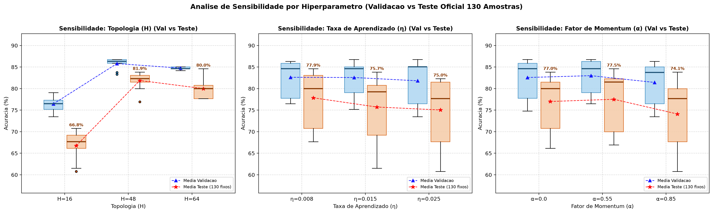
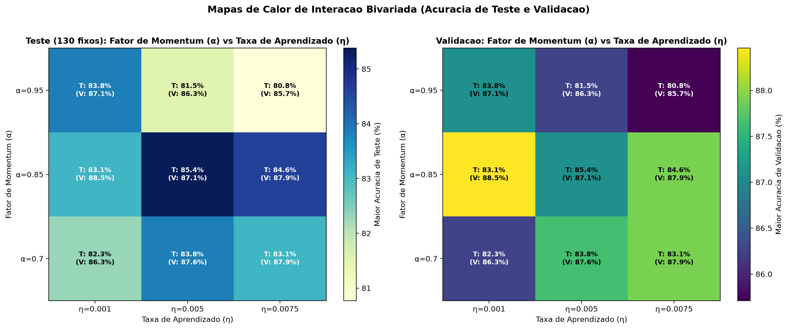
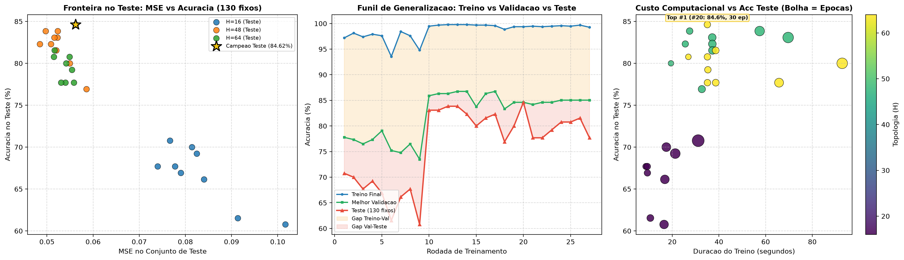
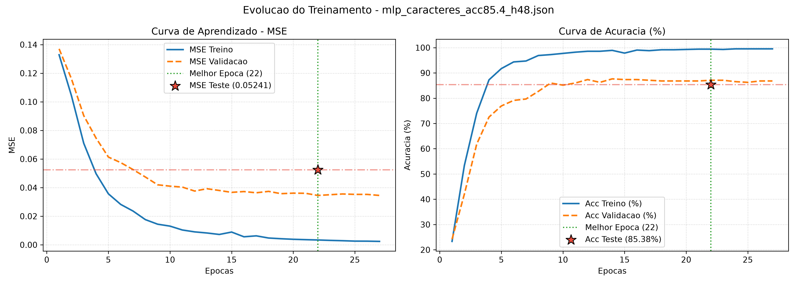
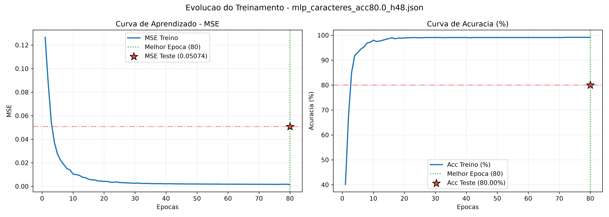
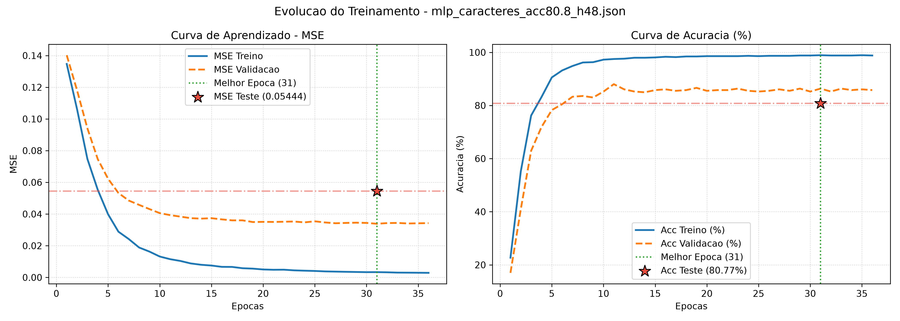
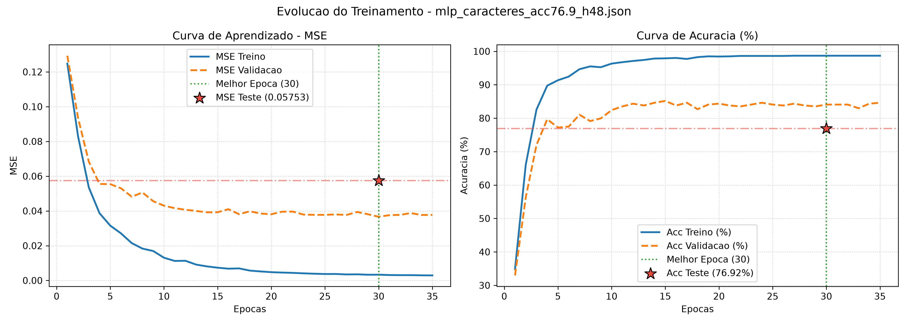

# Guia Completo — Seus Slides 6 a 11 + Roteiro de Gravação (MLP)

> **Integrantes do Grupo (EACH-USP | IA 2026 — Entrega 1: MLP):**
> - **Guilherme Oliveira de Souza** — Nº USP: `14671388`
> - **Paulo Rogerio Andrade de Oliveira** — Nº USP: `9365783`
> - **Victor Hugo Antunes Valadares** — Nº USP: `14760317`

Este arquivo segue o mesmo formato prático do `cnn/roteiro.md` e cobre **toda a sua parte oficial da apresentação (Slides 6 a 11)**:
1. **Mapa rápido das imagens prontas em `artefatos_entrega/`** para arrastar direto para o Canva / PowerPoint.
2. **Estrutura visual e textos/códigos 100% fiéis ao `src/` (com docstrings e comentários)** para colar nos slides (`Slide 6`, `Slide 7`, `Slide 8.1`, `Slide 8.2`, `Slide 9`, `Slide 10`, `Slide 11.1` e `Slide 11.2`).
3. **Roteiro falado cronometrado (~7 a 7,5 min no total)** com indicação exata de quando mostrar os Slides, o VS Code e o vídeo acelerado do Terminal.

---

## 1. Arquivos de Imagem Prontos (em `artefatos_entrega/`)

- **Para o Slide 8.2 (Busca de Parâmetros):**
  - `artefatos_entrega/slide_08_determinacao_parametros/1_sensibilidade_geral_H16_48_64_LR_M.png`
  - `artefatos_entrega/slide_08_determinacao_parametros/4_heatmap_LR_vs_Momentum_85.4pct.png`
  - `artefatos_entrega/slide_08_determinacao_parametros/5_heatmap_zoom_fino_plato_85.4pct.png`
- **Para o Slide 9 (Dinâmica e Custo Computacional):**
  - `artefatos_entrega/slide_09_dinamica_e_custo/1_custo_computacional_H16_H48_H64.png`
  - `artefatos_entrega/slide_09_dinamica_e_custo/2_custo_e_funil_campeao_85.4pct.png`
- **Para os Slides 10 e 11 (Se você gravar Parada Antecipada):**
  - `artefatos_entrega/slide_10_e_11_parada_antecipada_curvas/1_curva_campeao_momentum_com_es_85.4pct.png`
  - `artefatos_entrega/slide_10_e_11_parada_antecipada_curvas/2_curva_gd_puro_com_es_83.8pct.png`
  - `artefatos_entrega/slide_10_e_11_parada_antecipada_curvas/3_curva_sem_estratificacao_80.8pct.png`
  - `artefatos_entrega/slide_10_e_11_parada_antecipada_curvas/4_curva_com_ruido_15pct_76.9pct.png`
  - `artefatos_entrega/slide_10_e_11_parada_antecipada_curvas/5_curva_sem_parada_antecipada_80ep_80.0pct.png`

---

## 2. Montagem dos Slides (Canva / PowerPoint)

> [!IMPORTANT]
> **Regra do template da professora (`Slide 12`):** *"Você pode usar mais slides, entre os tópicos que coloquei ou depois para questões adicionais, mas NÃO altere a ordem de apresentação dos tópicos."*
> Por isso, mantemos exatamente os títulos oficiais de cada tópico e apenas desdobramos o Tópico 8 em `8.1` e `8.2` (e o 11 em `11.1` e `11.2`) para não espremer tabelas e gráficos.

---

### **SLIDE 6 — Atualização de pesos sinápticos**

**Título do Slide:** `Atualização de pesos sinápticos`

**Coluna da Esquerda (Explicação Teórica + Ordem de Execução):**
- **Ordem Estrita do Backpropagation (`MLP._update_weights`):**
  1. Calcula $\delta_k$ da camada de saída (`_compute_output_deltas`).
  2. Retropropaga $\delta_j$ para a camada escondida (`_compute_hidden_deltas`) **usando a matriz $W$ original intacta**.
  3. Só então altera os pesos sinápticos $W$ (saída) e $V$ (oculta) (`_apply_weight_updates`).
- **Regra Delta Generalizada + Termo de Momentum ($\mu$):**
  - **Camada de Saída ($W$):** $\Delta w_{jk}(t) = \alpha \cdot \delta_k \cdot z_j + \mu \cdot \Delta w_{jk}(t-1)$
  - **Camada Escondida ($V$):** $\Delta v_{ij}(t) = \alpha \cdot \delta_j \cdot x_i + \mu \cdot \Delta v_{ij}(t-1)$
  - **Biases ($b$):** $\Delta b_i(t) = \alpha \cdot \delta_i + \mu \cdot \Delta b_i(t-1)$
  - Quando `momentum = 0.0`, executa o **Gradiente Descendente puro**; quando `momentum > 0` (ex.: `0.85`), adiciona inércia da atualização anterior.

**Coluna da Direita (2 Cards de Código Separados — 100% Fiéis ao `src/`):**

- **Card 6A — Orquestração Modular (`src/core/models/mlp.py`, linhas 250–260):**
```python
def _update_weights(self, target: list[float], outputs: list[float]) -> None:
    """
    Orquestra a fase de Backpropagation em 3 etapas modulares (Passos 6, 7 e 8 de Fausett):
    1. Calcula informação de erro na camada de saída (δ_k)
    2. Calcula contribuição do erro na camada escondida (δ_j)
    3. Atualiza pesos e biases de todas as camadas (ΔW e ΔV)
    """
    output_deltas = self._compute_output_deltas(target, outputs)
    hidden_deltas_per_layer = self._compute_hidden_deltas(output_deltas)
    self._apply_weight_updates(output_deltas, hidden_deltas_per_layer)
```

- **Card 6B — Regra Delta + Momentum na Camada (`src/core/models/layer.py`, linhas 144–173):**
```python
def update_weights(
    self,
    deltas: list[float],
    learn_rate: float,
    momentum: float = 0.0,
) -> None:
    """
    Atualiza os pesos sinápticos e biases da camada via Gradiente Descendente
    (Passo 8 de Fausett — Slide 6), com suporte opcional a termo de Momentum (μ):
    - Bias:  Δw_0 = α * δ + μ * Δw_0(t-1)       =>  w_0 <- w_0 + Δw_0
    - Pesos: Δw_ji = α * δ * x_i + μ * Δw_ji(t-1) =>  w_ji <- w_ji + Δw_ji
    """
    for i_neuron in range(self.num_neurons):
        delta_i = deltas[i_neuron]

        # Correção e atualização do bias
        delta_bias = (learn_rate * delta_i) + (
            momentum * self.last_delta_bias[i_neuron]
        )
        self.bias[i_neuron] += delta_bias
        self.last_delta_bias[i_neuron] = delta_bias

        # Correção e atualização dos pesos conectados às entradas da camada
        for j_input in range(self.num_inputs):
            inp_val = self.last_inputs[j_input]
            delta_w = (learn_rate * delta_i * inp_val) + (
                momentum * self.last_delta_weights[i_neuron][j_input]
            )
            self.weights[i_neuron][j_input] += delta_w
            self.last_delta_weights[i_neuron][j_input] = delta_w
```

---

### **SLIDE 7 — Resposta de reconhecimento de caractere**

**Título do Slide:** `Resposta de reconhecimento de caractere`

**Coluna da Esquerda (Como a rede decide a letra `'A'..'Z'`):**
- **Saída Contínua da Rede (`outputs`):**
  - Vetor de **26 ativações reais** $y = [y_0, y_1, \dots, y_{25}]$ produzidas pela função **Sigmoide Bipolar** no intervalo contínuo $(-1, +1)$.
- **Regra de Decisão (*Winner-Takes-All* via `argmax`):**
  - `predict_class(outputs)` retorna o índice $k^* = \arg\max_k (y_k)$ do neurônio com **maior ativação contínua**, evitando empates ou ambiguidade de limiar fixo.
  - `recognize_character(inputs)` converte o índice $k^* \in \{0..25\}$ de volta no caractere correspondente (`chr(ord("A") + pred_idx)` $\rightarrow$ `'A'` a `'Z'`).
- **Geração dos Arquivos Oficiais de Teste (130 amostras):**
  - **Saídas Contínuas (`saidas_teste_continuas.csv`):** valores brutos $y_k \in (-1, +1)$.
  - **Saídas Discretas (`saidas_teste_discretas.csv`):** vetor *One-Hot Bipolar* com **+1.0** no neurônio vencedor $k^*$ e **-1.0** nos demais 25 neurônios.

**Coluna da Direita (2 Cards de Código Separados — 100% Fiéis ao `src/`):**

- **Card 7A — Decisão Winner-Takes-All (`src/core/models/mlp.py`, linhas 98–104):**
```python
def predict_class(self, outputs: list[float]) -> int:
    """
    Procedimento de decisão para reconhecimento de caractere (Slide 7):
    Aplica a regra Winner-Takes-All (argmax), selecionando o índice do neurônio
    de saída k com maior valor de ativação contínua y_k.
    """
    return int(np.argmax(outputs))
```

- **Card 7B — Inferência e Mapeamento para `'A'..'Z'` (`src/core/models/mlp.py`, linhas 106–116):**
```python
def recognize_character(
    self, inputs: list[float], class_labels: list[str] | None = None
) -> tuple[int, str, list[float]]:
    """
    Realiza a inferência para uma amostra de caractere e retorna (índice, letra, vetor_saída).
    """
    outputs = self.predict(inputs)
    pred_idx = self.predict_class(outputs)
    labels = class_labels or [chr(ord("A") + i) for i in range(self.num_outputs)]
    pred_char = labels[pred_idx] if pred_idx < len(labels) else str(pred_idx)
    return pred_idx, pred_char, outputs
```

---

### **SLIDE 8.1 — Determinação de parâmetros (Parametrização via CLI e Funil de Busca)**

**Título do Slide:** `Determinação de parâmetros — Parametrização e Estratégia de Busca (1/2)`

**Bloco 1 — Como determinamos e variamos os parâmetros na execução:**
- **100% parametrizável via linha de comando (`Makefile` + variáveis de ambiente em `src/training/config.py`)**, sem necessidade de alterar o código-fonte:
```bash
make full_pipeline NUM_EPOCHS=120 HIDDEN_NEURONS=48 LEARN_RATE=0.005 \
     MOMENTUM=0.85 PATIENCE=5 VAL_RATIO=0.30 STRATIFIED=true NOISE_RATE=0.0
```
- **Parâmetros configuráveis na execução:**
  1. `HIDDEN_NEURONS` ($H$): quantidade de neurônios na camada escondida (ex.: `16, 32, 48, 64`).
  2. `LEARN_RATE` ($\eta$): taxa de aprendizado (ex.: `0.001` a `0.05`).
  3. `MOMENTUM` ($\mu$): fator inercial do otimizador (`0.0` = GD Puro até `0.90`).
  4. `VAL_RATIO` e `STRATIFIED`: proporção de validação (`0.0` a `0.30`) e divisão estratificada por alfabeto vs. sorteio aleatório.
  5. `PATIENCE`, `NUM_EPOCHS` e `TARGET_MSE`: gatilhos de parada antecipada pelo MSE de validação.
  6. `NOISE_RATE` e `SEED`: taxa de ruído bipolar estocástico (`0.0` a `0.25`) e semente de reprodutibilidade (`42`).

**Bloco 2 — Procedimento de Busca em Funil (4 Grids Progressivos na Fase Final):**
- **Grid 1 (Varredura Ampla — 18 modelos):** $H \in \{16, 48, 64\}$, $\eta \in \{0.001, 0.005, 0.025\}$, $\mu \in \{0.0, 0.85\} \rightarrow$ descartou $H=16$ (*underfitting*: `66,8%` teste) e apontou $H=48$ como melhor média (`81,9%` teste / `85,8%` val).
- **Grid 2 (Proporção de Validação):** `VAL_RATIO` $\in \{10\%, 20\%, 30\%\} \rightarrow$ `30%` (`364` amostras = 14 alfabetos) estabilizou o MSE de validação (`85,9%` média).
- **Grid 3 (Refinamento com `PATIENCE=5` — 12 modelos):** $H \in \{48, 64\} \times \eta \in \{0.001, 0.005, 0.025\} \times \mu \in \{0.85, 0.90\} \rightarrow$ atingiu o pico de **85,38% no teste (111/130)** em `H=48, LR=0.005, M=0.85`.
- **Grid 4 (Zoom Fino no Platô Campeão — 9 modelos):** $\eta \in \{0.004, 0.005, 0.006\} \times \mu \in \{0.825, 0.85, 0.875\} \rightarrow$ média da grade inteira em **84,19% no teste** e **87,33% na validação** (3 modelos cravando **85,38%**).

---

### **SLIDE 8.2 — Determinação de parâmetros (Sensibilidade dos Hiperparâmetros)**

**Título do Slide:** `Determinação de parâmetros — O que mais influencia o resultado? (2/2)`

**Coluna da Esquerda (Principais Descobertas Críticas):**
- **1. Topologia ($H$) é o divisor entre *Underfitting* e Capacidade Ideal:**
  - $H=16$ comprime 120 pixels em apenas 16 neurônios $\rightarrow$ sofre *underfitting* severo (**66,8% média no teste**).
  - $H=48$ (`7.082` pesos) atinge o ponto ótimo (**83,1% média / 85,38% pico no teste**), superando $H=64$ (`9.434` pesos, **81,2% média** e 33% mais lento).
- **2. Interação Forte entre Taxa de Aprendizado ($\eta$) e Momentum ($\mu$):**
  - Como nossa atualização é **online (padrão a padrão, 832 ajustes por época)**, o passo efetivo é amplificado por $\frac{1}{1-\mu}$.
  - Combinar passo alto ($\eta = 0.025$) com momentum alto ($\mu = 0.90$) causa oscilação na superfície do MSE, derrubando o teste para **78,5%**.
  - O ponto doce é **passo moderado ($\eta = 0.005$) + inércia alta ($\mu = 0.85$)** $\rightarrow$ **85,38% no teste**.

**Coluna da Direita (Imagens — colocar lado a lado ou em cima/embaixo):**
- Inserir `1_sensibilidade_geral_H16_48_64_LR_M.png` e `4_heatmap_LR_vs_Momentum_85.4pct.png` (ou `5_heatmap_zoom_fino_plato_85.4pct.png`):




---

### **SLIDE 9 — Dinâmica de treinamento e teste**

**Título do Slide:** `Dinâmica de treinamento e teste — Hardware, Épocas e Tempo`

**Topo do Slide (Especificação do Hardware):**
- 💻 **Hardware Utilizado:** `Desktop Intel Core i5-14600KF (12+8 cores @ 5.30 GHz) | 32 GB RAM DDR5 6000MT/s Kingston | Execução em CPU single-core (Python 3.12)` sobre o conjunto `CARACTERES COMPLETO` (`832` treino / `364` validação / `130` teste fixo).

**Coluna da Esquerda (As 2 Tabelas Obrigatórias do Slide 9):**

**Tabela 1 — Neurônios na Camada Escondida ($H$) $\times$ Tempo $\times$ Épocas:**

| Camada Oculta ($H$) | Pesos Treináveis | Épocas Médias | Tempo Médio Total | Custo por Época | Acc Val Média (Máx) | Acc Teste Máx |
| :---: | :---: | :---: | :---: | :---: | :---: | :---: |
| **$H = 16$** | $2.378$ | $50,3\text{ ép.}$ | $15,69\text{ s}$ | **$0,31\text{ s/ép.}$** | $76,45\%$ ($79,06\%$) | $70,77\%$ |
| **$H = 48$** | $7.082$ | $43,2\text{ ép.}$ | $34,32\text{ s}$ | **$0,79\text{ s/ép.}$** | **$87,16\%$ ($88,46\%$)** | **$85,38\%$** |
| **$H = 64$** | $9.434$ | $46,8\text{ ép.}$ | $49,27\text{ s}$ | **$1,05\text{ s/ép.}$** | $85,51\%$ ($86,81\%$) | $84,62\%$ |

**Tabela 2 — Taxa de Aprendizado ($\eta$) e Momentum ($\mu$) $\times$ Tempo $\times$ Épocas (`H=48`):**

| Variação | Valor | Épocas | Tempo Total | Custo / Época | Acc Val | Acc Teste |
| :--- | :---: | :---: | :---: | :---: | :---: | :---: |
| **Learn Rate ($\eta$)** | $\eta = 0.001$ | $73,3\text{ ép.}$ | $58,29\text{ s}$ | $0,79\text{ s/ép.}$ | $87,27\%$ | $83,08\%$ ($83,85\%$) |
| **Learn Rate ($\eta$)** | $\eta = 0.005$ | **$29,0\text{ ép.}$** | **$22,97\text{ s}$** | $0,79\text{ s/ép.}$ | $87,00\%$ | **$83,59\%$ ($85,38\%$)** |
| **Learn Rate ($\eta$)** | $\eta = 0.025$ | $26,8\text{ ép.}$ | $24,24\text{ s}$ | $0,91\text{ s/ép.}$ | $85,99\%$ | $79,81\%$ ($82,31\%$) |
| **Sem Momentum** | $\mu = 0.00$ (GD Puro) | $119\text{ ép.}$ | $95,00\text{ s}$ | $0,80\text{ s/ép.}$ | **$88,46\%$** | $83,85\%$ |
| **Com Momentum** | $\mu = 0.85$ (Campeão) | **$27\text{ ép.}$** | **$21,56\text{ s}$ (-77%)** | $0,80\text{ s/ép.}$ | $87,09\%$ | **$85,38\%$** |

**Coluna da Direita (Gráfico de Custo + Síntese Analítica):**
- Inserir `1_custo_computacional_H16_H48_H64.png` (ou `2_custo_e_funil_campeao_85.4pct.png`):
  - **Custo por época é linear em $H$:** $0,31\text{s} \rightarrow 0,79\text{s} \rightarrow 1,05\text{s}$.
  - **Quantidade de épocas depende de $\eta$ e $\mu$:** o Momentum ($\mu=0.85$) cortou o treino de **119 épocas (`95,0s`) para 27 épocas (`21,6s`) — 4,4x mais rápido** e com +1,53 pp no teste!



---

### **SLIDE 10 — Treinamento e parada antecipada (Divisão dos Conjuntos + 2 Execuções)**

**Título do Slide:** `Treinamento e parada antecipada`

**Coluna da Esquerda (Divisão Estrita do `CARACTERES COMPLETO` = 1.326 amostras / 51 alfabetos):**
- **Conjunto deTeste Fixo (`130` amostras — índices `1196..1325`):**
  - Últimas **130 linhas** do arquivo = **5 alfabetos completos de A a Z**, isoladas conforme a especificação e nunca vistas durante o treino.
- **Conjunto de Treinamento (`832` amostras — 70% das 1.196 iniciais):**
  - **32 alfabetos completos** (`32 × 26 = 832`) amostrados de forma estratificada.
- **Conjunto de Validação (`364` amostras — 30% das 1.196 iniciais):**
  - **14 alfabetos completos** (`14 × 26 = 364`) monitorados a cada época para acionar a Parada Antecipada pelo **menor MSE de validação** + *rollback* para `best_weights`.

**Coluna da Direita (Comparativo das 2 Execuções no Terminal — `H=48, LR=0.005`):**
- **Execução 1 — Campeão com Momentum (`M=0.85, PATIENCE=5`):**
  - **Época 1:** `MSE Treino = 0.0725` | `MSE Val = 0.0568` (`59,3%` acc)
  - **Melhor Época (22):** `MSE Treino = 0.0239` | **`MSE Val Mínimo = 0.03451`** (`87,09%` acc)
  - **Parada (Época 27):** 5 épocas sem melhora $\rightarrow$ restaura pesos da Época 22 (`21,56s`)
  - **Resultado no Teste (130 fixos):** **`MSE Teste = 0.05241` | `Acurácia = 85,38% (111/130)`**
- **Execução 2 — Gradiente Descendente Puro (`M=0.00, PATIENCE=10`):**
  - **Época 1:** `MSE Treino = 0.1194` | `MSE Val = 0.1041` (`31,9%` acc)
  - **Melhor Época (109):** `MSE Treino = 0.0172` | **`MSE Val Mínimo = 0.03513`** (`88,46%` acc)
  - **Parada (Época 119):** restaura pesos da Época 109 (`95,00s` — **4,4x mais lento**)
  - **Resultado no Teste (130 fixos):** **`MSE Teste = 0.05582` | `Acurácia = 83,85% (109/130)`**

**🎬 Como gravar as 2 Execuções para o Slide 10 (Com Vídeo do Terminal Acelerado + Voz em 1x):**
- Como a professora autorizou **acelerar o vídeo da execução mantendo a voz em 1x** (e o próprio Slide 10 permite **incorporar o vídeo da execução direto no slide**), fica muito mais fácil:
  1. Grave apenas a janela do terminal rodando os 2 comandos abaixo em sequência.
  2. Acelere o clipe do terminal na edição (ex.: `2x` na Execução 1 para durar ~10s, e `8x` na Execução 2 para durar ~12s, congelando 3 segundinhos no sumário final de cada uma).
  3. Coloque esse vídeo acelerado direto dentro do **Slide 10 no Canva** (ou na timeline de edição) e grave sua voz em velocidade normal (`1x`) narrando por cima sem precisar trocar de janela ao vivo!

```bash
# Execução 1 — Campeão com Momentum 0.85 (27 épocas em ~21s -> acelerado 2x vira ~10s):
make train NUM_EPOCHS=120 HIDDEN_NEURONS=48 LEARN_RATE=0.005 MOMENTUM=0.85 PATIENCE=5 VAL_RATIO=0.30 STRATIFIED=true

# Execução 2 — GD Puro sem Momentum 0.00 (119 épocas em ~95s -> acelerado 8x vira ~12s):
make train NUM_EPOCHS=150 HIDDEN_NEURONS=48 LEARN_RATE=0.005 MOMENTUM=0.00 PATIENCE=10 VAL_RATIO=0.30 STRATIFIED=true
```

**O que aparece no console ao final da Execução 1 (e que cumpre 100% dos requisitos do PDF):**
```text
ÉPOCA    | MSE TREINO   | ACC TREINO   | MSE VAL      | ACC VAL
--------------------------------------------------------------------
1        | 0.07254      | 57.57     % | 0.05682      | 59.34%
...
22       | 0.02389      | 82.81     % | 0.03451      | 87.09%
...
27       | 0.02114      | 85.46     % | 0.03512      | 86.54%
====================================================================
Tempo total de execução : 21.56s (0:00:21.560000)
Total de épocas         : 27 / 120
Divisão dos conjuntos   : Treino=832 | Validação=364 | Teste=130
Critério de Parada      : Parada Antecipada (Early Stopping) acionada após 5 épocas sem redução no MSE de validação.
Melhor Época (MSE Val)  : 22 | Menor MSE Val: 0.034510 | Acc Val na Época: 87.09% (pesos restaurados)
Treino (Última Época)   : MSE = 0.021140 | Acc = 85.46%
Validação (Última Época): MSE = 0.035120 | Acc = 86.54%
Teste Final (130 fixos) : MSE = 0.052412 | Acc = 85.38%
====================================================================
```

---

### **SLIDE 11.1 — Parada antecipada (Com vs. Sem Parada Antecipada e GD Puro)**

**Título do Slide:** `Parada antecipada — Evolução do MSE e Prevenção de Overfitting (1/2)`

**Coluna da Esquerda (Campeão com Parada Antecipada — `85,38%` em 27 épocas):**
- Linha verde tracejada marca o **mínimo global do MSE de validação (Época 22: `0.03451`)**.
- Estrela vermelha (`★`) destaca o desempenho dos pesos restaurados nos **130 exemplos fixos de teste (`85,38%`)**.


**Coluna da Direita (Sem Parada Antecipada — 80 Épocas Fixas $\rightarrow$ Queda para `80,00%`):**
- Sem validação (`VAL_RATIO=0.0`), o treino decora as amostras (`99,16%`, `MSE = 0.0061`), mas os pesos saturam e a acurácia no teste **cai **-5,38 pp** (`85,38%` $\rightarrow$ `80,00%`)**!


---

### **SLIDE 11.2 — Parada antecipada (Ambientes Dificultados: Sem Estratificação e Com Ruído)**

**Título do Slide:** `Parada antecipada — Ambientes de Experimentação Dificultados (2/2)`

**Coluna da Esquerda (Ambiente Dificultado 1 — Amostragem Aleatória Sem Estratificação: `80,77%`):**
- `STRATIFIED=false`: o sorteio aleatório desbalanceia a proporção de letras entre treino e validação.
- O MSE de validação atinge um falso mínimo (`0.03386` na época 31), derrubando a generalização no teste em ****-4,61 pp** (`85,38%` $\rightarrow$ `80,77%`)**.


**Coluna da Direita (Ambiente Dificultado 2 — Ruído Bipolar de 15% nos Pixels: `76,92%`):**
- `NOISE_RATE=0.15`: invertemos estocasticamente **15% dos pixels (**-1 ↔ +1**)** nas matrizes $12 \times 10$.
- A parada antecipada ainda protege a rede de colapsar, mas o patamar mínimo de MSE sobe e a acurácia no teste cai ****-8,46 pp** (`85,38%` $\rightarrow$ `76,92%`)**.


---

## 3. Roteiro Falado Passo a Passo Cronometrado

> **🎬 PREPARAÇÃO ANTES DE DAR REC (30 segundos):**
> 1. Deixe o **Canva / PowerPoint** aberto na sua apresentação.
> 2. Deixe o **VS Code** aberto ao lado com 3 abas já posicionadas (sem precisar digitar nada ao vivo):
>    - Aba 1: `src/core/models/layer.py` paradinho na **linha 144** (`def update_weights`).
>    - Aba 2: `src/core/models/mlp.py` paradinho na **linha 98** (`def predict_class` e `def recognize_character`) — e rolando um pouco chega na **linha 250** (`def _update_weights`).
>    - Aba 3: `src/training/config.py` na **linha 40** (`from_env`) ou `Makefile` para mostrar como os parâmetros entram via CLI.
> 3. Lembre de manter a **webcam ligada** num canto da tela e falar em **velocidade normal (1x)**.

---

### ⏱️ **[0:00 – 1:10] Tópico 6: Atualização de Pesos Sinápticos (Slide 6 + Passada rápida no VS Code)**

**[COMEÇA NO SLIDE 6]**

*"Pessoal, dando sequência na explicação do algoritmo de treinamento da nossa MLP, agora no **Slide 6** eu vou mostrar como implementamos a **atualização dos pesos sinápticos** após o cálculo dos erros de retropropagação.*

*Um cuidado fundamental de implementação que tomamos — seguindo fielmente a teoria do Backpropagation — está na ordem de execução dentro do método `_update_weights` da classe `MLP` (linhas 250 a 260): primeiro nós calculamos todos os deltas da camada de saída ($\delta_k$) e retropropagamos os deltas da camada escondida ($\delta_j$) usando a matriz de pesos $W$ **ainda intacta**, antes de alterar qualquer peso. Só depois que todos os deltas estão prontos é que chamamos `_apply_weight_updates`.*

**[👉 AÇÃO NA TELA: Alterna rapidamente para o VS Code na aba `src/core/models/layer.py` na linha 144]**

*Olhando aqui diretamente no nosso código em `layer.py`, nas linhas 144 a 173, temos o método `update_weights`:*
- *Para cada neurônio `i_neuron` da camada, nas linhas 159 a 164, atualizamos primeiro o **bias**: calculamos `delta_bias` multiplicando a taxa de aprendizado `learn_rate` pelo `delta_i` daquele neurônio, somado ao termo de `momentum` vezes a variação anterior `last_delta_bias`.*
- *Logo abaixo, no laço das linhas 167 a 173, percorremos cada entrada `j_input` conectada a esse neurônio — que na camada escondida são os 120 pixels $x_i$ e na camada de saída são as ativações ocultas $z_j$ salvas em `self.last_inputs` — e aplicamos a Regra Delta Generalizada: `learn_rate * delta_i * inp_val` mais o termo inercial `momentum * last_delta_weights`. Quando `momentum` é zero, temos o Gradiente Descendente puro exigido na especificação; quando ativamos `momentum = 0.85`, aceleramos drasticamente a descida."*

---

### ⏱️ **[1:10 – 2:00] Tópico 7: Resposta de Reconhecimento de Caractere (VS Code `mlp.py` $\rightarrow$ Slide 7)**

**[👉 AÇÃO NA TELA: Clica na aba `src/core/models/mlp.py` na linha 98 e depois volta para o SLIDE 7]**

*"Passando para a **resposta de reconhecimento de caractere**, aqui em `mlp.py` nas linhas 98 a 116 — e também resumido no **Slide 7**:*
- *Como a nossa camada de saída possui **26 neurônios** (um para cada letra de A a Z) ativados pela função **Sigmoide Bipolar**, o método `predict` devolve um vetor de 26 valores reais contínuos no intervalo entre **-1** e **+1**.*
- *Para transformar esse vetor contínuo na decisão da letra reconhecida, implementamos a estratégia **Winner-Takes-All** no método `predict_class` (linha 98) usando `np.argmax(outputs)`: o neurônio que apresentar a **maior ativação contínua** vence a disputa, o que evita empates ou indecisões que aconteceriam se usássemos um limiar rígido.*
- *Em seguida, o método `recognize_character` (linha 106) mapeia o índice vencedor de `0 a 25` diretamente para o caractere `'A'` a `'Z'`, além de exportar nos arquivos finais tanto as saídas contínuas em $(-1, +1)$ quanto as saídas discretas convertidas em **-1** e **+1**."*

---

### ⏱️ **[2:00 – 3:35] Tópico 8: Determinação de Parâmetros (Slides 8.1 e 8.2)**

**[👉 AÇÃO NA TELA: Avança para o SLIDE 8.1]**

*"Entrando agora na parte experimental, no **Slide 8.1** explicamos como determinamos e buscamos os parâmetros da arquitetura.*
- *Primeiro, quanto à **forma de parametrização**: toda a nossa implementação é controlada via linha de comando pelo `Makefile` e por variáveis de ambiente lidas em `src/training/config.py`, sem precisar editar código entre um teste e outro. Na execução, podemos variar livremente o número de neurônios ocultos (`HIDDEN_NEURONS`), taxa de aprendizado (`LEARN_RATE`), `MOMENTUM`, proporção de validação (`VAL_RATIO`), amostragem estratificada (`STRATIFIED`), paciência da parada antecipada (`PATIENCE`) e até injeção de ruído (`NOISE_RATE`).*
- *Segundo, para encontrar a melhor configuração no conjunto `CARACTERES COMPLETO` — mantendo sempre as últimas **130 amostras (5 alfabetos completos)** isoladas como conjunto de teste fixo — nós adotamos um **procedimento de busca em funil em 4 baterias de Grid Search**.*

**[👉 AÇÃO NA TELA: Avança para o SLIDE 8.2 (Gráficos de Sensibilidade e Heatmap)]**

*Olhando os gráficos aqui no **Slide 8.2**, fica muito claro quais parâmetros mais influenciam o sucesso da rede:*
1. *O parâmetro mais crítico para a capacidade da rede é o **número de neurônios na camada escondida ($H$)**: no gráfico superior vemos que com **$H=16$** a rede sofre um *underfitting* severo, ficando com média de apenas **66,8% no teste**, porque 16 neurônios não conseguem comprimir a variabilidade de 120 pixels para 26 letras em diferentes fontes. Quando subimos para **$H=48$**, a média no teste salta mais de 15 pontos percentuais e atinge o pico de **85,38% (111 acertos em 130)** — superando inclusive $H=64$, que adiciona mais de 2.300 pesos sem ganho de generalização.*
2. *O segundo fator determinante, visível no mapa de calor abaixo, é a **interação entre Taxa de Aprendizado ($\eta$) e Momentum ($\mu$)**: como o treinamento é online (atualizando os pesos 832 vezes por época), taxas altas como `0.025` combinadas com momentum alto (`0.90`) causam passos largos demais e instabilidade, caindo para `78,5%`. Já a combinação de **taxa moderada ($\eta = 0.005$) com momentum $\mu = 0.85$ e paciência 5** formou um platô extremamente estável: no nosso zoom fino ao redor desse ponto, a média dos 9 modelos testados foi de **84,19% no teste** e **87,33% na validação**, confirmando a solidez do modelo campeão de **85,38%**."*

---

### ⏱️ **[3:35 – 4:50] Tópico 9: Dinâmica de Treinamento e Teste (Slide 9)**

**[👉 AÇÃO NA TELA: Avança para o SLIDE 9 (Tabelas de Tempo e Gráfico de Custo)]**

*"No **Slide 9**, detalhamos a dinâmica de execução e o custo computacional dos treinamentos no conjunto `CARACTERES COMPLETO`, executados em um desktop com processador **Intel Core i5-14600KF a 5.30 GHz e 32 GB de RAM DDR5**, rodando em CPU single-core.*

*Analisando criticamente as duas tabelas de desempenho:*
- *Na **Tabela 1**, quando variamos a **quantidade de neurônios na camada escondida ($H$)**, observamos que o **custo computacional por época cresce de forma estritamente linear** com o número de pesos: $H=16$ (2.378 pesos) leva **0,31 segundo por época**; $H=48$ (7.082 pesos) leva **0,79 segundo por época**; e $H=64$ (9.434 pesos) sobe para **1,05 segundo por época**. Ou seja, $H=48$ entrega a maior acurácia de validação e teste custando 25% menos tempo por época que $H=64$.*
- *Já na **Tabela 2**, mantendo $H=48$ fixo e variando a **taxa de aprendizado ($\eta$)** e o **otimizador ($\mu$)**, vemos que o custo por época permanece constante em ~`0,79s`, mas a **quantidade de épocas até a convergência muda drasticamente**:*
  - *Com taxa muito baixa ($\eta = 0.001$), a rede precisa de **73,3 épocas médias (`58,3 segundos`)** para convergir.*
  - *Com $\eta = 0.005$, o tempo cai pela metade: **29 épocas médias (`23 segundos`)**.*
  - *E o destaque principal está nas duas últimas linhas da tabela: comparando o **Gradiente Descendente Puro ($\mu = 0.00$)** com o nosso modelo **Com Momentum ($\mu = 0.85$)** na mesma arquitetura, o GD Puro precisou de **119 épocas e 95 segundos** para atingir `83,85%` no teste, enquanto o Momentum convergiu em apenas **27 épocas e 21,56 segundos** cravando **85,38%** — uma **redução de 77% no tempo de treinamento (4,4 vezes mais rápido)** e com melhor generalização."*

---

### ⏱️ **[4:50 – 6:10] Tópico 10: Treinamento e Parada Antecipada (Slide 10 com Vídeo Acelerado das 2 Execuções)**

**[👉 AÇÃO NA TELA: Avança para o SLIDE 10 e dá Play no vídeo acelerado do terminal embutido no slide (ou na edição) enquanto fala em 1x]**

*"Avançando para o **Slide 10**, detalhamos a divisão exata dos conjuntos de dados e acompanhamos o vídeo acelerado das duas execuções completas no nosso terminal com parada antecipada.*
- *Sobre a **divisão dos conjuntos**: o arquivo `CARACTERES COMPLETO` possui `1.326` exemplos (51 alfabetos de 26 letras). Seguindo a especificação, isolamos de forma fixa as **últimas 130 amostras (5 alfabetos completos, linhas 1197 a 1326)** exclusivamente para o **Conjunto de Teste**. Das `1.196` amostras restantes, aplicamos amostragem estratificada por classe separando **70% para Treinamento (832 amostras = 32 alfabetos)** e **30% para Validação (364 amostras = 14 alfabetos)**.*
- *Acompanhando as duas execuções mostradas no terminal e resumidas à direita:*
  1. *Na **Execução 1 (Campeão com Momentum 0.85 e Paciência 5)**, o erro quadrático médio (MSE) cai rapidamente de `0.0725` no treino e `0.0568` na validação na Época 1 até atingir o **menor MSE de validação na Época 22 (`0.03451`, com 87,09% de acurácia)**. Como nas 5 épocas seguintes (23 a 27) o MSE de validação não melhora, o treino para na Época 27, o nosso orquestrador restaura automaticamente os pesos da Época 22 (`rollback`) e avalia nos 130 exemplos inéditos de teste, obtendo **MSE de teste `0.05241` e acurácia de 85,38% (111/130)**.*
  2. *Já na **Execução 2 (Gradiente Descendente Puro sem Momentum)**, a descida do erro é muito mais gradual: o MSE de validação só atinge seu mínimo na **Época 109 (`0.03513`)**, parando na Época 119 com **83,85% no teste**."*

---

### ⏱️ **[6:10 – 7:30] Tópico 11: Parada Antecipada e Ambientes Dificultados (Slides 11.1 e 11.2)**

**[👉 AÇÃO NA TELA: Avança para o SLIDE 11.1]**

*"No **Slide 11.1**, ilustramos graficamente a importância da parada antecipada minimizando o Erro Quadrático Médio (MSE):*
- *À esquerda temos a curva do modelo campeão, onde a linha vertical verde indica o ponto exato de corte na Época 22 antes que a curva laranja de validação comece a subir.*
- *À direita, mostramos o contraste treinando a mesma rede **sem parada antecipada por 80 épocas fixas**: o MSE de treino cai quase a zero (`0.0061`, decorando `99,16%` do treino), mas a saturação dos pesos degrada a generalização e derruba a acurácia de teste (estrela vermelha) de **85,38% para 80,00% (-5,38 pontos percentuais)**.*

**[👉 AÇÃO NA TELA: Avança para o SLIDE 11.2]**

*Por fim, no **Slide 11.2**, atendendo à sugestão do template de **dificultar o ambiente de experimentação** para estressar a parada antecipada, realizamos dois experimentos adicionais:*
1. *À esquerda, **removemos a estratificação (`STRATIFIED=false`)**, sorteando treino e validação de forma puramente aleatória: como algumas letras ficam sub-representadas na validação, o gatilho de parada perde precisão e a acurácia no teste cai para **80,77% (-4,61 pp)**.*
2. *À direita, **injetamos 15% de ruído bipolar (`NOISE_RATE=0.15`)**, invertendo pixels aleatoriamente nos dados de desenvolvimento: vemos que a curva de MSE se estabiliza num patamar mais alto e ruidoso, mas a parada antecipada ainda consegue frear o treinamento na época 30 e garantir **76,92% de acerto (100/130)** no teste oficial. Agora passo a palavra para o Victor para a análise das Matrizes de Confusão e implementações adicionais."*

---

## 4. Cola Rápida de Arquivos e Linhas para Mostrar no VS Code

| Slide | Arquivo para abrir no VS Code | Linhas | O que apontar com o mouse |
| :---: | :--- | :---: | :--- |
| **Slide 6** | `src/core/models/mlp.py` | **250–260** | `_update_weights`: calcula `output_deltas` e `hidden_deltas` antes de `_apply_weight_updates`. |
| **Slide 6** | `src/core/models/layer.py` | **144–173** | `update_weights`: atualização de `self.bias` e `self.weights` com `learn_rate` e `momentum`. |
| **Slide 7** | `src/core/models/mlp.py` | **98–116** | `predict_class` (`np.argmax(outputs)`) e `recognize_character` (mapeia `0..25` $\rightarrow$ `'A'..'Z'`). |
| **Slide 8** | `src/training/config.py` (ou `Makefile`) | **40–75** | `MLPConfig.from_env()`: leitura de `HIDDEN_NEURONS`, `LEARN_RATE`, `MOMENTUM`, `PATIENCE`, `VAL_RATIO`. |
| **Slide 10** | `src/training/orchestrator.py` | **91–136** | Monitoramento de `val_mse < best_val_mse`, contador `_patience_counter` e rollback `best_weights`. |
