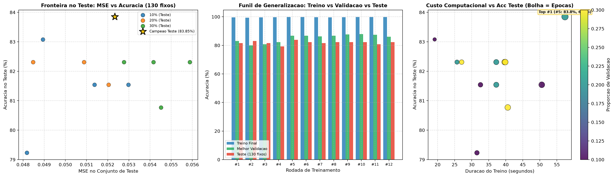
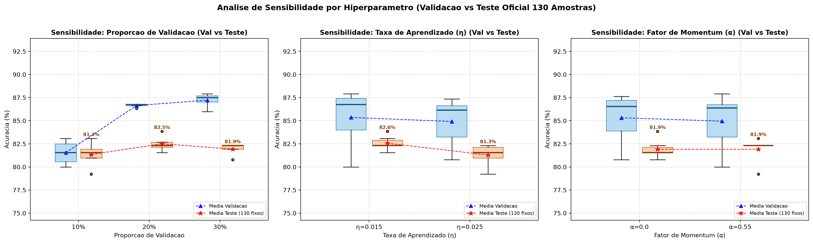
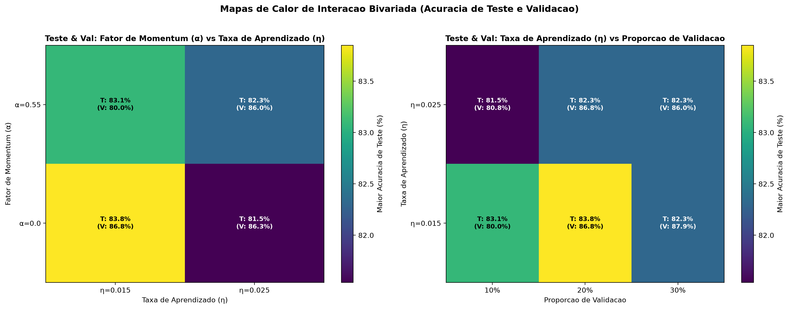

# Relatorio Analitico e Visual — Grid Search

- **Total de Modelos Treinados:** `12` combinacoes
- **Esforco Computacional Total:** `503` epocas acumuladas em `438.4s` (`7.3 min`)
- **Conjunto de Avaliacao Final:** `130 amostras fixas de Teste` (ultimos 5 alfabetos completos, indices `1196..1325`)


## 1. Destaques da Execucao (Campeoes por Criterio)

| Criterio | Rodada | Configuracao | Acc Teste (130 fixos) | MSE Teste | Acc Val (Melhor Ep) | MSE Val | Epocas / Tempo | Checkpoint |
| :--- | :---: | :--- | :---: | :---: | :---: | :---: | :---: | :--- |
| **Campeao no Teste (Maior Acc)** | #5 | `H=48, LR=0.015, M=0.0, Val=0.2, P=10, Noise=0.0` | **83.85%** | **0.05234** | 86.75% (Ep 55) | 0.04042 | 65 ep (57.4s) | `gs_acc83.8_h48.json` |
| **Campeao na Validacao (Menor MSE)** | #10 | `H=48, LR=0.015, M=0.55, Val=0.3, P=10, Noise=0.0` | 82.31% | 0.05416 | **87.91%** (Ep 40) | **0.03335** | 50 ep (39.9s) | `gs_acc82.3_h48_v4.json` |
| **Melhor Custo-Beneficio (Mais Rapido no Topo)** | #2 | `H=48, LR=0.015, M=0.55, Val=0.1, P=10, Noise=0.0` | **83.08%** | 0.04894 | 80.00% (Ep 10) | 0.04666 | **20 ep (19.1s)** | `gs_acc83.1_h48.json` |



## 2. Sensibilidade por Proporcao de Validacao (Val Ratio)

| Val Ratio | N | Acc Teste Media (Visual) | Acc Teste Max | MSE Teste Min | Acc Val Media (Max) | MSE Val Min | Gap Val→Teste | Epocas Medias | Tempo Medio (s/ep) |
| :---: | :---: | :--- | :---: | :---: | :---: | :---: | :---: | :---: | :---: |
| **10.0% (0.10)** | 4 | `██████░░░░` **81.35%** | **83.08%** | 0.04818 | 81.54% (83.08%) | 0.04443 | +0.19% | 35.0 ep | 33.45s (`0.96s/ep`) |
| **20.0% (0.20)** | 4 | `███████░░░` **82.50%** | **83.85%** | 0.04847 | 86.64% (86.75%) | 0.03788 | +4.14% | 44.5 ep | 39.37s (`0.88s/ep`) |
| **30.0% (0.30)** | 4 | `███████░░░` **81.92%** | **82.31%** | 0.05277 | 87.22% (87.91%) | 0.03335 | +5.30% | 46.2 ep | 36.79s (`0.80s/ep`) |

## 3. Sensibilidade por Taxa de Aprendizado (Learn Rate)

| Taxa (η) | N | Acc Teste Media (Visual) | Acc Teste Max | MSE Teste Min | Acc Val Media (Max) | MSE Val Min | Gap Val→Teste | Epocas Medias | Tempo Medio (s/ep) |
| :---: | :---: | :--- | :---: | :---: | :---: | :---: | :---: | :---: | :---: |
| **η = 0.015** | 6 | `███████░░░` **82.57%** | **83.85%** | 0.04894 | 85.36% (87.91%) | 0.03335 | +2.79% | 46.7 ep | 40.63s (`0.87s/ep`) |
| **η = 0.025** | 6 | `██████░░░░` **81.28%** | **82.31%** | 0.04818 | 84.92% (87.36%) | 0.03428 | +3.63% | 37.2 ep | 32.44s (`0.87s/ep`) |

## 4. Sensibilidade por Fator de Momentum

| Momentum (α) | N | Acc Teste Media (Visual) | Acc Teste Max | MSE Teste Min | Acc Val Media (Max) | MSE Val Min | Gap Val→Teste | Epocas Medias | Tempo Medio (s/ep) |
| :---: | :---: | :--- | :---: | :---: | :---: | :---: | :---: | :---: | :---: |
| **α = 0.0** | 6 | `███████░░░` **81.92%** | **83.85%** | 0.05138 | 85.32% (87.64%) | 0.03434 | +3.40% | 49.2 ep | 42.99s (`0.87s/ep`) |
| **α = 0.55** | 6 | `███████░░░` **81.92%** | **83.08%** | 0.04818 | 84.95% (87.91%) | 0.03335 | +3.03% | 34.7 ep | 30.08s (`0.87s/ep`) |





## 5. Funil de Generalizacao (Treino → Validacao → Teste)

```text
  Treino Final      : [████████████████████] Media:  99.67% | Max:  99.79%
                           │  (Queda media Treino → Validacao : -14.53 pp)
                           ▼
  Melhor Validacao  : [██████████████░░░░░░] Media:  85.14% | Max:  87.91%
                           │  (Queda media Validacao → Teste  : -3.21 pp)
                           ▼
  Teste (130 fixos) : [█████████████░░░░░░░] Media:  81.92% | Max:  83.85%
```

- **Gap Total Medio (Treino → Teste):** `+17.74%` (Treino→Val: `+14.53%` | Val→Teste: `+3.21%`)
- **Menor Desvio Val→Teste:** Rodada #3 (Val: `80.77%` → Teste: `81.54%` | Gap: `-0.77%`)
- **Menor Sobreajuste Treino→Val:** Rodada #10 (Treino: `99.76%` → Val: `87.91%` | Gap: `+11.85%`)
- **Distribuicao do Sobreajuste (Treino - Validacao):**
  - Baixo (`<= 5%`): **0/12** modelos
  - Moderado (`5% a 15%`): **8/12** modelos
  - Alto (`> 15%`): **4/12** modelos


## 6. Ranking Top 10 Modelos (Ordenado por Acuracia de Teste)

| Pos | Rodada | H | Val | LR | Mom | P | Noise | Acc Teste (Visual) | MSE Teste | Acc Val (Ep) | MSE Val | Acc Treino | Epocas | Tempo (s/ep) | Checkpoint |
| :---: | :---: | :---: | :---: | :---: | :---: | :---: | :---: | :--- | :---: | :---: | :---: | :---: | :---: | :---: | :--- |
| **#1** | #5 | 48 | 0.20 | 0.015 | 0.0 | 10 | 0.00 | `███████░` **83.85%** | 0.05234 | 86.75% (Ep 55) | 0.04042 | 99.79% | 65 | 57.4s (`0.88s`) | `gs_acc83.8_h48.json` |
| **#2** | #2 | 48 | 0.10 | 0.015 | 0.55 | 10 | 0.00 | `██████░░` **83.08%** | 0.04894 | 80.00% (Ep 10) | 0.04666 | 99.34% | 20 | 19.1s (`0.96s`) | `gs_acc83.1_h48.json` |
| **#3** | #8 | 48 | 0.20 | 0.025 | 0.55 | 10 | 0.00 | `██████░░` **82.31%** | 0.04847 | 86.75% (Ep 19) | 0.03788 | 99.58% | 29 | 25.7s (`0.89s`) | `gs_acc82.3_h48_v2.json` |
| **#4** | #6 | 48 | 0.20 | 0.015 | 0.55 | 10 | 0.00 | `██████░░` **82.31%** | 0.05088 | 86.75% (Ep 32) | 0.03839 | 99.79% | 42 | 37.2s (`0.89s`) | `gs_acc82.3_h48.json` |
| **#5** | #12 | 48 | 0.30 | 0.025 | 0.55 | 10 | 0.00 | `██████░░` **82.31%** | 0.05277 | 85.99% (Ep 32) | 0.03428 | 99.76% | 34 | 27.1s (`0.80s`) | `gs_acc82.3_h48_v5.json` |
| **#6** | #10 | 48 | 0.30 | 0.015 | 0.55 | 10 | 0.00 | `██████░░` **82.31%** | 0.05416 | 87.91% (Ep 40) | 0.03335 | 99.76% | 50 | 39.9s (`0.80s`) | `gs_acc82.3_h48_v4.json` |
| **#7** | #9 | 48 | 0.30 | 0.015 | 0.0 | 10 | 0.00 | `██████░░` **82.31%** | 0.05588 | 87.64% (Ep 40) | 0.03459 | 99.64% | 50 | 39.7s (`0.79s`) | `gs_acc82.3_h48_v3.json` |
| **#8** | #3 | 48 | 0.10 | 0.025 | 0.0 | 10 | 0.00 | `█████░░░` **81.54%** | 0.05138 | 80.77% (Ep 24) | 0.04766 | 99.62% | 34 | 32.6s (`0.96s`) | `gs_acc81.5_h48_v2.json` |
| **#9** | #7 | 48 | 0.20 | 0.025 | 0.0 | 10 | 0.00 | `█████░░░` **81.54%** | 0.05204 | 86.32% (Ep 32) | 0.03909 | 99.69% | 42 | 37.2s (`0.89s`) | `gs_acc81.5_h48_v3.json` |
| **#10** | #1 | 48 | 0.10 | 0.015 | 0.0 | 10 | 0.00 | `█████░░░` **81.54%** | 0.05298 | 83.08% (Ep 43) | 0.04560 | 99.53% | 53 | 50.6s (`0.95s`) | `gs_acc81.5_h48.json` |
