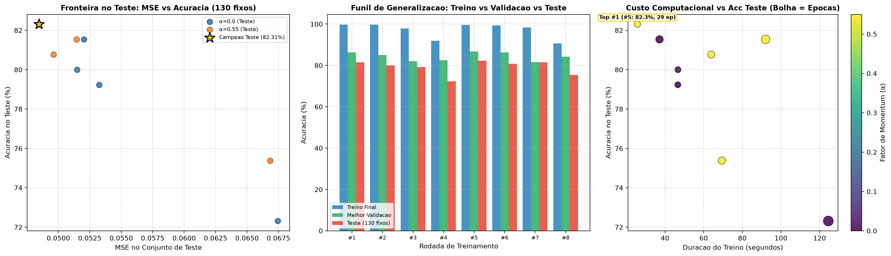
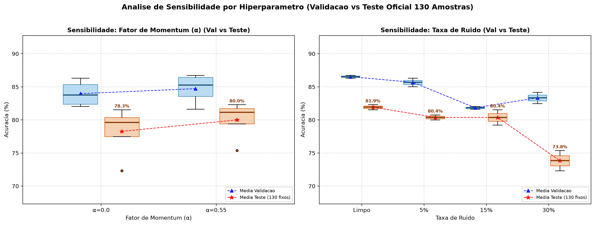
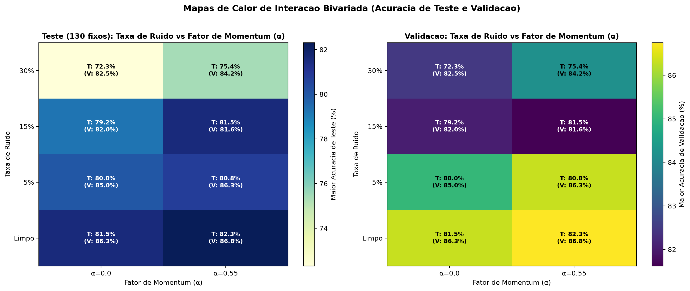

# Relatorio Analitico e Visual — Grid Search

- **Total de Modelos Treinados:** `8` combinacoes
- **Esforco Computacional Total:** `327` epocas acumuladas em `506.1s` (`8.4 min`)
- **Conjunto de Avaliacao Final:** `130 amostras fixas de Teste` (ultimos 5 alfabetos completos, indices `1196..1325`)


## 1. Destaques da Execucao (Campeoes por Criterio)

| Criterio | Rodada | Configuracao | Acc Teste (130 fixos) | MSE Teste | Acc Val (Melhor Ep) | MSE Val | Epocas / Tempo | Checkpoint |
| :--- | :---: | :--- | :---: | :---: | :---: | :---: | :---: | :--- |
| **Campeao no Teste (Maior Acc)** | #5 | `H=48, LR=0.025, M=0.55, Val=0.2, P=10, Noise=0.0` | **82.31%** | **0.04847** | 86.75% (Ep 19) | 0.03788 | 29 ep (25.8s) | `gs_acc82.3_h48.json` |
| **Campeao na Validacao (Menor MSE)** | #6 | `H=48, LR=0.025, M=0.55, Val=0.2, P=10, Noise=0.05` | 80.77% | 0.04962 | **86.32%** (Ep 27) | **0.03701** | 37 ep (64.0s) | `gs_acc80.8_h48.json` |
| **Melhor Custo-Beneficio (Mais Rapido no Topo)** | #5 | `H=48, LR=0.025, M=0.55, Val=0.2, P=10, Noise=0.0` | **82.31%** | 0.04847 | 86.75% (Ep 19) | 0.03788 | **29 ep (25.8s)** | `gs_acc82.3_h48.json` |



## 2. Sensibilidade por Fator de Momentum

| Momentum (α) | N | Acc Teste Media (Visual) | Acc Teste Max | MSE Teste Min | Acc Val Media (Max) | MSE Val Min | Gap Val→Teste | Epocas Medias | Tempo Medio (s/ep) |
| :---: | :---: | :--- | :---: | :---: | :---: | :---: | :---: | :---: | :---: |
| **α = 0.0** | 4 | `██████░░░░` **78.27%** | **81.54%** | 0.05148 | 83.97% (86.32%) | 0.03909 | +5.70% | 42.0 ep | 63.75s (`1.52s/ep`) |
| **α = 0.55** | 4 | `███████░░░` **80.00%** | **82.31%** | 0.04847 | 84.72% (86.75%) | 0.03701 | +4.72% | 39.8 ep | 62.79s (`1.58s/ep`) |

## 3. Sensibilidade por Taxa de Ruido (Data Augmentation)

| Ruido | N | Acc Teste Media (Visual) | Acc Teste Max | MSE Teste Min | Acc Val Media (Max) | MSE Val Min | Gap Val→Teste | Epocas Medias | Tempo Medio (s/ep) |
| :---: | :---: | :--- | :---: | :---: | :---: | :---: | :---: | :---: | :---: |
| **0.0% (Limpo)** | 2 | `█████████░` **81.93%** | **82.31%** | 0.04847 | 86.53% (86.75%) | 0.03788 | +4.61% | 35.5 ep | 31.45s (`0.89s/ep`) |
| **5.0%** | 2 | `████████░░` **80.38%** | **80.77%** | 0.04962 | 85.68% (86.32%) | 0.03701 | +5.29% | 32.0 ep | 55.32s (`1.73s/ep`) |
| **15.0%** | 2 | `████████░░` **80.39%** | **81.54%** | 0.05145 | 81.84% (82.05%) | 0.04027 | +1.45% | 40.0 ep | 69.34s (`1.73s/ep`) |
| **30.0%** | 2 | `████░░░░░░` **73.84%** | **75.38%** | 0.06683 | 83.34% (84.19%) | 0.04106 | +9.49% | 56.0 ep | 96.97s (`1.73s/ep`) |





## 4. Funil de Generalizacao (Treino → Validacao → Teste)

```text
  Treino Final      : [███████████████████░] Media:  97.14% | Max:  99.69%
                           │  (Queda media Treino → Validacao : -12.79 pp)
                           ▼
  Melhor Validacao  : [██████████████░░░░░░] Media:  84.35% | Max:  86.75%
                           │  (Queda media Validacao → Teste  : -5.21 pp)
                           ▼
  Teste (130 fixos) : [████████████░░░░░░░░] Media:  79.14% | Max:  82.31%
```

- **Gap Total Medio (Treino → Teste):** `+18.00%` (Treino→Val: `+12.79%` | Val→Teste: `+5.21%`)
- **Menor Desvio Val→Teste:** Rodada #7 (Val: `81.62%` → Teste: `81.54%` | Gap: `+0.08%`)
- **Menor Sobreajuste Treino→Val:** Rodada #8 (Treino: `90.70%` → Val: `84.19%` | Gap: `+6.51%`)
- **Distribuicao do Sobreajuste (Treino - Validacao):**
  - Baixo (`<= 5%`): **0/8** modelos
  - Moderado (`5% a 15%`): **6/8** modelos
  - Alto (`> 15%`): **2/8** modelos


## 5. Ranking Top 8 Modelos (Ordenado por Acuracia de Teste)

| Pos | Rodada | H | Val | LR | Mom | P | Noise | Acc Teste (Visual) | MSE Teste | Acc Val (Ep) | MSE Val | Acc Treino | Epocas | Tempo (s/ep) | Checkpoint |
| :---: | :---: | :---: | :---: | :---: | :---: | :---: | :---: | :--- | :---: | :---: | :---: | :---: | :---: | :---: | :--- |
| **#1** | #5 | 48 | 0.20 | 0.025 | 0.55 | 10 | 0.00 | `███████░` **82.31%** | 0.04847 | 86.75% (Ep 19) | 0.03788 | 99.58% | 29 | 25.8s (`0.89s`) | `gs_acc82.3_h48.json` |
| **#2** | #7 | 48 | 0.20 | 0.025 | 0.55 | 10 | 0.15 | `███████░` **81.54%** | 0.05145 | 81.62% (Ep 43) | 0.04027 | 98.28% | 53 | 92.0s (`1.74s`) | `gs_acc81.5_h48_v2.json` |
| **#3** | #1 | 48 | 0.20 | 0.025 | 0.0 | 10 | 0.00 | `███████░` **81.54%** | 0.05204 | 86.32% (Ep 32) | 0.03909 | 99.69% | 42 | 37.1s (`0.89s`) | `gs_acc81.5_h48.json` |
| **#4** | #6 | 48 | 0.20 | 0.025 | 0.55 | 10 | 0.05 | `██████░░` **80.77%** | 0.04962 | 86.32% (Ep 27) | 0.03701 | 99.38% | 37 | 64.0s (`1.73s`) | `gs_acc80.8_h48.json` |
| **#5** | #2 | 48 | 0.20 | 0.025 | 0.0 | 10 | 0.05 | `██████░░` **80.00%** | 0.05148 | 85.04% (Ep 17) | 0.03990 | 99.69% | 27 | 46.7s (`1.73s`) | `gs_acc80.0_h48.json` |
| **#6** | #3 | 48 | 0.20 | 0.025 | 0.0 | 10 | 0.15 | `██████░░` **79.23%** | 0.05325 | 82.05% (Ep 17) | 0.04457 | 97.87% | 27 | 46.6s (`1.73s`) | `gs_acc79.2_h48.json` |
| **#7** | #8 | 48 | 0.20 | 0.025 | 0.55 | 10 | 0.30 | `████░░░░` **75.38%** | 0.06683 | 84.19% (Ep 30) | 0.04261 | 90.70% | 40 | 69.4s (`1.74s`) | `gs_acc75.4_h48.json` |
| **#8** | #4 | 48 | 0.20 | 0.025 | 0.0 | 10 | 0.30 | `██░░░░░░` **72.31%** | 0.06744 | 82.48% (Ep 62) | 0.04106 | 91.89% | 72 | 124.5s (`1.73s`) | `gs_acc72.3_h48.json` |
