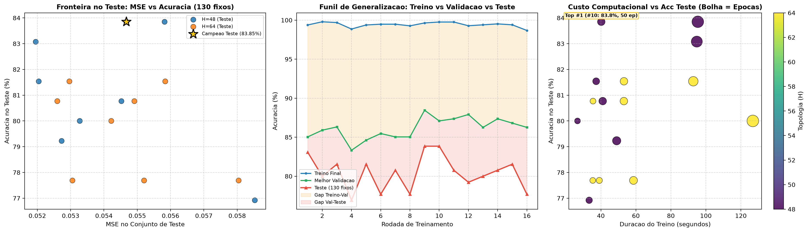
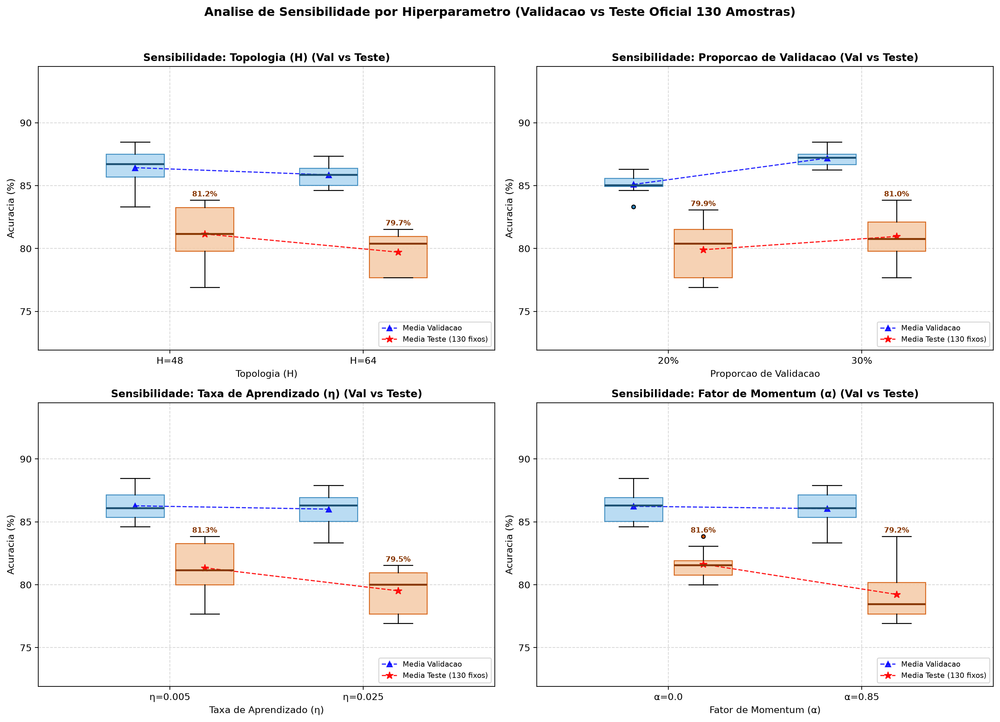
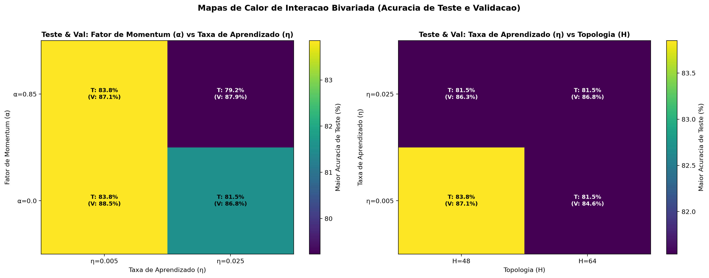

# Relatorio Analitico e Visual — Grid Search

- **Total de Modelos Treinados:** `16` combinacoes
- **Esforco Computacional Total:** `943` epocas acumuladas em `912.3s` (`15.2 min`)
- **Conjunto de Avaliacao Final:** `130 amostras fixas de Teste` (ultimos 5 alfabetos completos, indices `1196..1325`)


## 1. Destaques da Execucao (Campeoes por Criterio)

| Criterio | Rodada | Configuracao | Acc Teste (130 fixos) | MSE Teste | Acc Val (Melhor Ep) | MSE Val | Epocas / Tempo | Checkpoint |
| :--- | :---: | :--- | :---: | :---: | :---: | :---: | :---: | :--- |
| **Campeao no Teste (Maior Acc)** | #10 | `H=48, LR=0.005, M=0.85, Val=0.3, P=10, Noise=0.0` | **83.85%** | **0.05467** | 87.09% (Ep 40) | 0.03316 | 50 ep (40.2s) | `gs_acc83.8_h48_v2.json` |
| **Campeao na Validacao (Menor MSE)** | #12 | `H=48, LR=0.025, M=0.85, Val=0.3, P=10, Noise=0.0` | 79.23% | 0.05273 | **87.91%** (Ep 51) | **0.03106** | 61 ep (49.0s) | `-` |
| **Melhor Custo-Beneficio (Mais Rapido no Topo)** | #10 | `H=48, LR=0.005, M=0.85, Val=0.3, P=10, Noise=0.0` | **83.85%** | 0.05467 | 87.09% (Ep 40) | 0.03316 | **50 ep (40.2s)** | `gs_acc83.8_h48_v2.json` |



## 2. Sensibilidade por Topologia (Neuronios Ocultos H)

| Neuronios (H) | N | Acc Teste Media (Visual) | Acc Teste Max | MSE Teste Min | Acc Val Media (Max) | MSE Val Min | Gap Val→Teste | Epocas Medias | Tempo Medio (s/ep) |
| :---: | :---: | :--- | :---: | :---: | :---: | :---: | :---: | :---: | :---: |
| **H=48** | 8 | `███████░░░` **81.16%** | **83.85%** | 0.05195 | 86.43% (88.46%) | 0.03106 | +5.27% | 62.1 ep | 52.21s (`0.84s/ep`) |
| **H=64** | 8 | `██████░░░░` **79.71%** | **81.54%** | 0.05260 | 85.86% (87.36%) | 0.03198 | +6.15% | 55.8 ep | 61.82s (`1.11s/ep`) |

## 3. Sensibilidade por Proporcao de Validacao (Val Ratio)

| Val Ratio | N | Acc Teste Media (Visual) | Acc Teste Max | MSE Teste Min | Acc Val Media (Max) | MSE Val Min | Gap Val→Teste | Epocas Medias | Tempo Medio (s/ep) |
| :---: | :---: | :--- | :---: | :---: | :---: | :---: | :---: | :---: | :---: |
| **20.0% (0.20)** | 8 | `██████░░░░` **79.90%** | **83.08%** | 0.05195 | 85.09% (86.32%) | 0.03782 | +5.19% | 48.5 ep | 49.35s (`1.02s/ep`) |
| **30.0% (0.30)** | 8 | `██████░░░░` **80.96%** | **83.85%** | 0.05260 | 87.19% (88.46%) | 0.03106 | +6.23% | 69.4 ep | 64.68s (`0.93s/ep`) |

## 4. Sensibilidade por Taxa de Aprendizado (Learn Rate)

| Taxa (η) | N | Acc Teste Media (Visual) | Acc Teste Max | MSE Teste Min | Acc Val Media (Max) | MSE Val Min | Gap Val→Teste | Epocas Medias | Tempo Medio (s/ep) |
| :---: | :---: | :--- | :---: | :---: | :---: | :---: | :---: | :---: | :---: |
| **η = 0.005** | 8 | `███████░░░` **81.35%** | **83.85%** | 0.05195 | 86.28% (88.46%) | 0.03198 | +4.93% | 73.0 ep | 70.65s (`0.97s/ep`) |
| **η = 0.025** | 8 | `█████░░░░░` **79.52%** | **81.54%** | 0.05204 | 86.01% (87.91%) | 0.03106 | +6.49% | 44.9 ep | 43.38s (`0.97s/ep`) |

## 5. Sensibilidade por Fator de Momentum

| Momentum (α) | N | Acc Teste Media (Visual) | Acc Teste Max | MSE Teste Min | Acc Val Media (Max) | MSE Val Min | Gap Val→Teste | Epocas Medias | Tempo Medio (s/ep) |
| :---: | :---: | :--- | :---: | :---: | :---: | :---: | :---: | :---: | :---: |
| **α = 0.0** | 8 | `███████░░░` **81.64%** | **83.85%** | 0.05195 | 86.24% (88.46%) | 0.03308 | +4.60% | 74.6 ep | 72.11s (`0.97s/ep`) |
| **α = 0.85** | 8 | `█████░░░░░` **79.23%** | **83.85%** | 0.05260 | 86.05% (87.91%) | 0.03106 | +6.82% | 43.2 ep | 41.92s (`0.97s/ep`) |





## 6. Funil de Generalizacao (Treino → Validacao → Teste)

```text
  Treino Final      : [████████████████████] Media:  99.42% | Max:  99.79%
                           │  (Queda media Treino → Validacao : -13.28 pp)
                           ▼
  Melhor Validacao  : [██████████████░░░░░░] Media:  86.14% | Max:  88.46%
                           │  (Queda media Validacao → Teste  : -5.71 pp)
                           ▼
  Teste (130 fixos) : [████████████░░░░░░░░] Media:  80.43% | Max:  83.85%
```

- **Gap Total Medio (Treino → Teste):** `+18.99%` (Treino→Val: `+13.28%` | Val→Teste: `+5.71%`)
- **Menor Desvio Val→Teste:** Rodada #1 (Val: `85.04%` → Teste: `83.08%` | Gap: `+1.96%`)
- **Menor Sobreajuste Treino→Val:** Rodada #9 (Treino: `99.64%` → Val: `88.46%` | Gap: `+11.18%`)
- **Distribuicao do Sobreajuste (Treino - Validacao):**
  - Baixo (`<= 5%`): **0/16** modelos
  - Moderado (`5% a 15%`): **15/16** modelos
  - Alto (`> 15%`): **1/16** modelos


## 7. Ranking Top 10 Modelos (Ordenado por Acuracia de Teste)

| Pos | Rodada | H | Val | LR | Mom | P | Noise | Acc Teste (Visual) | MSE Teste | Acc Val (Ep) | MSE Val | Acc Treino | Epocas | Tempo (s/ep) | Checkpoint |
| :---: | :---: | :---: | :---: | :---: | :---: | :---: | :---: | :--- | :---: | :---: | :---: | :---: | :---: | :---: | :--- |
| **#1** | #10 | 48 | 0.30 | 0.005 | 0.85 | 10 | 0.00 | `███████░` **83.85%** | 0.05467 | 87.09% (Ep 40) | 0.03316 | 99.76% | 50 | 40.2s (`0.80s`) | `gs_acc83.8_h48_v2.json` |
| **#2** | #9 | 48 | 0.30 | 0.005 | 0.0 | 10 | 0.00 | `███████░` **83.85%** | 0.05582 | 88.46% (Ep 109) | 0.03513 | 99.64% | 119 | 95.4s (`0.80s`) | `gs_acc83.8_h48.json` |
| **#3** | #1 | 48 | 0.20 | 0.005 | 0.0 | 10 | 0.00 | `██████░░` **83.08%** | 0.05195 | 85.04% (Ep 97) | 0.04151 | 99.38% | 107 | 94.8s (`0.89s`) | `gs_acc83.1_h48.json` |
| **#4** | #3 | 48 | 0.20 | 0.025 | 0.0 | 10 | 0.00 | `██████░░` **81.54%** | 0.05204 | 86.32% (Ep 32) | 0.03909 | 99.69% | 42 | 37.3s (`0.89s`) | `gs_acc81.5_h48.json` |
| **#5** | #15 | 64 | 0.30 | 0.025 | 0.0 | 10 | 0.00 | `██████░░` **81.54%** | 0.05296 | 86.81% (Ep 40) | 0.03308 | 99.40% | 50 | 53.2s (`1.06s`) | `gs_acc81.5_h64_v2.json` |
| **#6** | #5 | 64 | 0.20 | 0.005 | 0.0 | 10 | 0.00 | `██████░░` **81.54%** | 0.05584 | 84.62% (Ep 69) | 0.04078 | 99.38% | 79 | 92.8s (`1.18s`) | `gs_acc81.5_h64.json` |
| **#7** | #14 | 64 | 0.30 | 0.005 | 0.85 | 10 | 0.00 | `█████░░░` **80.77%** | 0.05260 | 87.36% (Ep 40) | 0.03198 | 99.52% | 50 | 53.1s (`1.06s`) | `gs_acc80.8_h64_v2.json` |
| **#8** | #11 | 48 | 0.30 | 0.025 | 0.0 | 10 | 0.00 | `█████░░░` **80.77%** | 0.05452 | 87.36% (Ep 41) | 0.03434 | 99.76% | 51 | 41.0s (`0.81s`) | `gs_acc80.8_h48.json` |
| **#9** | #7 | 64 | 0.20 | 0.025 | 0.0 | 10 | 0.00 | `█████░░░` **80.77%** | 0.05491 | 85.04% (Ep 20) | 0.03891 | 99.48% | 30 | 35.5s (`1.18s`) | `gs_acc80.8_h64.json` |
| **#10** | #2 | 48 | 0.20 | 0.005 | 0.85 | 10 | 0.00 | `█████░░░` **80.00%** | 0.05327 | 85.90% (Ep 20) | 0.03835 | 99.79% | 30 | 26.6s (`0.89s`) | `gs_acc80.0_h48.json` |
