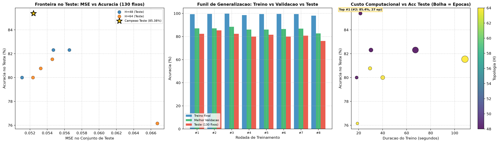
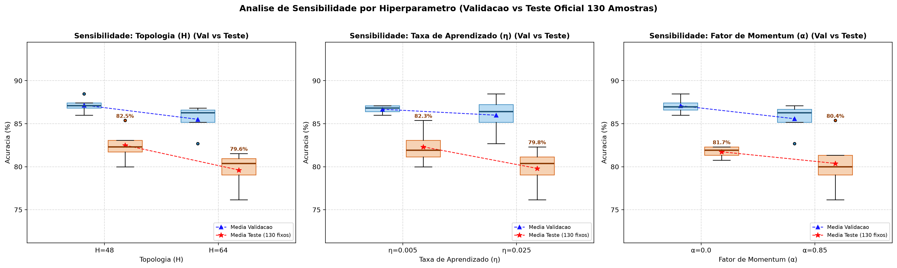
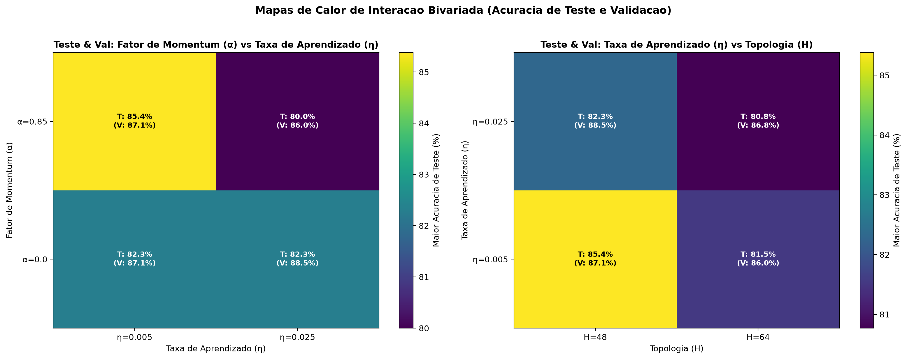

# Relatorio Analitico e Visual — Grid Search

- **Total de Modelos Treinados:** `8` combinacoes
- **Esforco Computacional Total:** `360` epocas acumuladas em `334.3s` (`5.6 min`)
- **Conjunto de Avaliacao Final:** `130 amostras fixas de Teste` (ultimos 5 alfabetos completos, indices `1196..1325`)


## 1. Destaques da Execucao (Campeoes por Criterio)

| Criterio | Rodada | Configuracao | Acc Teste (130 fixos) | MSE Teste | Acc Val (Melhor Ep) | MSE Val | Epocas / Tempo | Checkpoint |
| :--- | :---: | :--- | :---: | :---: | :---: | :---: | :---: | :--- |
| **Campeao no Teste (Maior Acc)** | #2 | `H=48, LR=0.005, M=0.85, Val=0.3, P=5, Noise=0.0` | **85.38%** | **0.05241** | 87.09% (Ep 22) | 0.03451 | 27 ep (21.4s) | `gs_acc85.4_h48.json` |
| **Campeao na Validacao (Menor MSE)** | #6 | `H=64, LR=0.005, M=0.85, Val=0.3, P=5, Noise=0.0` | 80.00% | 0.05235 | **86.54%** (Ep 33) | **0.03269** | 38 ep (40.1s) | `gs_acc80.0_h64.json` |
| **Melhor Custo-Beneficio (Mais Rapido no Topo)** | #2 | `H=48, LR=0.005, M=0.85, Val=0.3, P=5, Noise=0.0` | **85.38%** | 0.05241 | 87.09% (Ep 22) | 0.03451 | **27 ep (21.4s)** | `gs_acc85.4_h48.json` |



## 2. Sensibilidade por Topologia (Neuronios Ocultos H)

| Neuronios (H) | N | Acc Teste Media (Visual) | Acc Teste Max | MSE Teste Min | Acc Val Media (Max) | MSE Val Min | Gap Val→Teste | Epocas Medias | Tempo Medio (s/ep) |
| :---: | :---: | :--- | :---: | :---: | :---: | :---: | :---: | :---: | :---: |
| **H=48** | 4 | `███████░░░` **82.50%** | **85.38%** | 0.05108 | 87.16% (88.46%) | 0.03316 | +4.66% | 43.2 ep | 34.32s (`0.79s/ep`) |
| **H=64** | 4 | `█████░░░░░` **79.62%** | **81.54%** | 0.05235 | 85.51% (86.81%) | 0.03269 | +5.89% | 46.8 ep | 49.27s (`1.05s/ep`) |

## 3. Sensibilidade por Taxa de Aprendizado (Learn Rate)

| Taxa (η) | N | Acc Teste Media (Visual) | Acc Teste Max | MSE Teste Min | Acc Val Media (Max) | MSE Val Min | Gap Val→Teste | Epocas Medias | Tempo Medio (s/ep) |
| :---: | :---: | :--- | :---: | :---: | :---: | :---: | :---: | :---: | :---: |
| **η = 0.005** | 4 | `███████░░░` **82.31%** | **85.38%** | 0.05235 | 86.68% (87.09%) | 0.03269 | +4.37% | 63.2 ep | 59.35s (`0.94s/ep`) |
| **η = 0.025** | 4 | `█████░░░░░` **79.81%** | **82.31%** | 0.05108 | 85.99% (88.46%) | 0.03316 | +6.18% | 26.8 ep | 24.24s (`0.91s/ep`) |

## 4. Sensibilidade por Fator de Momentum

| Momentum (α) | N | Acc Teste Media (Visual) | Acc Teste Max | MSE Teste Min | Acc Val Media (Max) | MSE Val Min | Gap Val→Teste | Epocas Medias | Tempo Medio (s/ep) |
| :---: | :---: | :--- | :---: | :---: | :---: | :---: | :---: | :---: | :---: |
| **α = 0.0** | 4 | `███████░░░` **81.73%** | **82.31%** | 0.05323 | 87.09% (88.46%) | 0.03423 | +5.36% | 63.5 ep | 58.90s (`0.93s/ep`) |
| **α = 0.85** | 4 | `██████░░░░` **80.38%** | **85.38%** | 0.05108 | 85.58% (87.09%) | 0.03269 | +5.20% | 26.5 ep | 24.69s (`0.93s/ep`) |





## 5. Funil de Generalizacao (Treino → Validacao → Teste)

```text
  Treino Final      : [████████████████████] Media:  99.19% | Max:  99.76%
                           │  (Queda media Treino → Validacao : -12.86 pp)
                           ▼
  Melhor Validacao  : [███████████████░░░░░] Media:  86.33% | Max:  88.46%
                           │  (Queda media Validacao → Teste  : -5.27 pp)
                           ▼
  Teste (130 fixos) : [████████████░░░░░░░░] Media:  81.06% | Max:  85.38%
```

- **Gap Total Medio (Treino → Teste):** `+18.13%` (Treino→Val: `+12.86%` | Val→Teste: `+5.27%`)
- **Menor Desvio Val→Teste:** Rodada #2 (Val: `87.09%` → Teste: `85.38%` | Gap: `+1.71%`)
- **Menor Sobreajuste Treino→Val:** Rodada #3 (Treino: `99.76%` → Val: `88.46%` | Gap: `+11.30%`)
- **Distribuicao do Sobreajuste (Treino - Validacao):**
  - Baixo (`<= 5%`): **0/8** modelos
  - Moderado (`5% a 15%`): **7/8** modelos
  - Alto (`> 15%`): **1/8** modelos


## 6. Ranking Top 8 Modelos (Ordenado por Acuracia de Teste)

| Pos | Rodada | H | Val | LR | Mom | P | Noise | Acc Teste (Visual) | MSE Teste | Acc Val (Ep) | MSE Val | Acc Treino | Epocas | Tempo (s/ep) | Checkpoint |
| :---: | :---: | :---: | :---: | :---: | :---: | :---: | :---: | :--- | :---: | :---: | :---: | :---: | :---: | :---: | :--- |
| **#1** | #2 | 48 | 0.30 | 0.005 | 0.85 | 5 | 0.00 | `███████░` **85.38%** | 0.05241 | 87.09% (Ep 22) | 0.03451 | 99.52% | 27 | 21.4s (`0.79s`) | `gs_acc85.4_h48.json` |
| **#2** | #3 | 48 | 0.30 | 0.025 | 0.0 | 5 | 0.00 | `██████░░` **82.31%** | 0.05471 | 88.46% (Ep 33) | 0.03453 | 99.76% | 38 | 30.2s (`0.80s`) | `gs_acc82.3_h48_v2.json` |
| **#3** | #1 | 48 | 0.30 | 0.005 | 0.0 | 5 | 0.00 | `██████░░` **82.31%** | 0.05656 | 87.09% (Ep 80) | 0.03753 | 99.28% | 85 | 67.3s (`0.79s`) | `gs_acc82.3_h48.json` |
| **#4** | #5 | 64 | 0.30 | 0.005 | 0.0 | 5 | 0.00 | `█████░░░` **81.54%** | 0.05458 | 85.99% (Ep 98) | 0.03574 | 99.40% | 103 | 108.6s (`1.05s`) | `gs_acc81.5_h64.json` |
| **#5** | #7 | 64 | 0.30 | 0.025 | 0.0 | 5 | 0.00 | `█████░░░` **80.77%** | 0.05323 | 86.81% (Ep 23) | 0.03423 | 99.40% | 28 | 29.5s (`1.05s`) | `gs_acc80.8_h64.json` |
| **#6** | #4 | 48 | 0.30 | 0.025 | 0.85 | 5 | 0.00 | `████░░░░` **80.00%** | 0.05108 | 85.99% (Ep 18) | 0.03316 | 98.56% | 23 | 18.3s (`0.80s`) | `gs_acc80.0_h48.json` |
| **#7** | #6 | 64 | 0.30 | 0.005 | 0.85 | 5 | 0.00 | `████░░░░` **80.00%** | 0.05235 | 86.54% (Ep 33) | 0.03269 | 99.52% | 38 | 40.1s (`1.05s`) | `gs_acc80.0_h64.json` |
| **#8** | #8 | 64 | 0.30 | 0.025 | 0.85 | 5 | 0.00 | `██░░░░░░` **76.15%** | 0.06674 | 82.69% (Ep 13) | 0.03818 | 98.08% | 18 | 18.9s (`1.05s`) | `-` |
