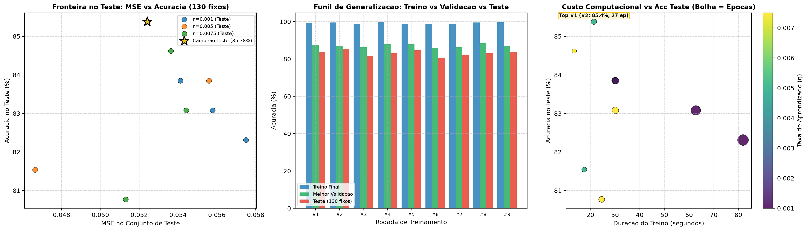
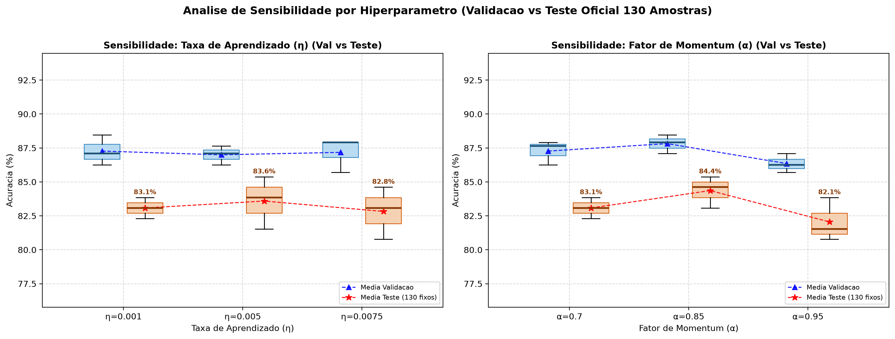
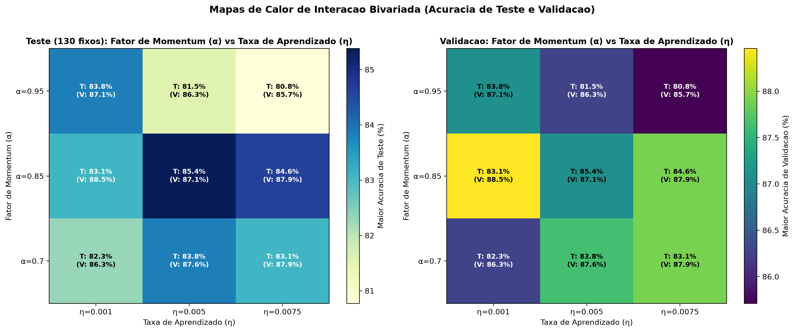

# Relatorio Analitico e Visual — Grid Search

- **Total de Modelos Treinados:** `9` combinacoes
- **Esforco Computacional Total:** `393` epocas acumuladas em `312.0s` (`5.2 min`)
- **Conjunto de Avaliacao Final:** `130 amostras fixas de Teste` (ultimos 5 alfabetos completos, indices `1196..1325`)


## 1. Destaques da Execucao (Campeoes por Criterio)

| Criterio | Rodada | Configuracao | Acc Teste (130 fixos) | MSE Teste | Acc Val (Melhor Ep) | MSE Val | Epocas / Tempo | Checkpoint |
| :--- | :---: | :--- | :---: | :---: | :---: | :---: | :---: | :--- |
| **Campeao no Teste (Maior Acc)** | #2 | `H=48, LR=0.005, M=0.85, Val=0.3, P=5, Noise=0.0` | **85.38%** | **0.05241** | 87.09% (Ep 22) | 0.03451 | 27 ep (21.4s) | `gs_acc85.4_h48.json` |
| **Campeao na Validacao (Menor MSE)** | #4 | `H=48, LR=0.0075, M=0.7, Val=0.3, P=5, Noise=0.0` | 83.08% | 0.05442 | **87.91%** (Ep 33) | **0.03437** | 38 ep (30.1s) | `-` |
| **Melhor Custo-Beneficio (Mais Rapido no Topo)** | #5 | `H=48, LR=0.0075, M=0.85, Val=0.3, P=5, Noise=0.0` | **84.62%** | 0.05363 | 87.91% (Ep 12) | 0.03543 | **17 ep (13.5s)** | `-` |



## 2. Sensibilidade por Taxa de Aprendizado (Learn Rate)

| Taxa (η) | N | Acc Teste Media (Visual) | Acc Teste Max | MSE Teste Min | Acc Val Media (Max) | MSE Val Min | Gap Val→Teste | Epocas Medias | Tempo Medio (s/ep) |
| :---: | :---: | :--- | :---: | :---: | :---: | :---: | :---: | :---: | :---: |
| **η = 0.001** | 3 | `██████░░░░` **83.08%** | **83.85%** | 0.05412 | 87.27% (88.46%) | 0.03477 | +4.19% | 73.3 ep | 58.29s (`0.79s/ep`) |
| **η = 0.005** | 3 | `███████░░░` **83.59%** | **85.38%** | 0.04664 | 87.00% (87.64%) | 0.03451 | +3.41% | 29.0 ep | 22.97s (`0.79s/ep`) |
| **η = 0.0075** | 3 | `██████░░░░` **82.82%** | **84.62%** | 0.05130 | 87.18% (87.91%) | 0.03437 | +4.35% | 28.7 ep | 22.74s (`0.79s/ep`) |

## 3. Sensibilidade por Fator de Momentum

| Momentum (α) | N | Acc Teste Media (Visual) | Acc Teste Max | MSE Teste Min | Acc Val Media (Max) | MSE Val Min | Gap Val→Teste | Epocas Medias | Tempo Medio (s/ep) |
| :---: | :---: | :--- | :---: | :---: | :---: | :---: | :---: | :---: | :---: |
| **α = 0.7** | 3 | `██████░░░░` **83.08%** | **83.85%** | 0.05442 | 87.27% (87.91%) | 0.03437 | +4.19% | 59.7 ep | 47.33s (`0.79s/ep`) |
| **α = 0.85** | 3 | `███████░░░` **84.36%** | **85.38%** | 0.05241 | 87.82% (88.46%) | 0.03451 | +3.46% | 41.0 ep | 32.56s (`0.79s/ep`) |
| **α = 0.95** | 3 | `█████░░░░░` **82.05%** | **83.85%** | 0.04664 | 86.35% (87.09%) | 0.03453 | +4.30% | 30.3 ep | 24.10s (`0.79s/ep`) |





## 4. Funil de Generalizacao (Treino → Validacao → Teste)

```text
  Treino Final      : [████████████████████] Media:  99.20% | Max:  99.76%
                           │  (Queda media Treino → Validacao : -12.05 pp)
                           ▼
  Melhor Validacao  : [███████████████░░░░░] Media:  87.15% | Max:  88.46%
                           │  (Queda media Validacao → Teste  : -3.98 pp)
                           ▼
  Teste (130 fixos) : [█████████████░░░░░░░] Media:  83.16% | Max:  85.38%
```

- **Gap Total Medio (Treino → Teste):** `+16.04%` (Treino→Val: `+12.05%` | Val→Teste: `+3.98%`)
- **Menor Desvio Val→Teste:** Rodada #2 (Val: `87.09%` → Teste: `85.38%` | Gap: `+1.71%`)
- **Menor Sobreajuste Treino→Val:** Rodada #5 (Treino: `98.80%` → Val: `87.91%` | Gap: `+10.89%`)
- **Distribuicao do Sobreajuste (Treino - Validacao):**
  - Baixo (`<= 5%`): **0/9** modelos
  - Moderado (`5% a 15%`): **9/9** modelos
  - Alto (`> 15%`): **0/9** modelos


## 5. Ranking Top 9 Modelos (Ordenado por Acuracia de Teste)

| Pos | Rodada | H | Val | LR | Mom | P | Noise | Acc Teste (Visual) | MSE Teste | Acc Val (Ep) | MSE Val | Acc Treino | Epocas | Tempo (s/ep) | Checkpoint |
| :---: | :---: | :---: | :---: | :---: | :---: | :---: | :---: | :--- | :---: | :---: | :---: | :---: | :---: | :---: | :--- |
| **#1** | #2 | 48 | 0.30 | 0.005 | 0.85 | 5 | 0.00 | `███████░` **85.38%** | 0.05241 | 87.09% (Ep 22) | 0.03451 | 99.52% | 27 | 21.4s (`0.79s`) | `gs_acc85.4_h48.json` |
| **#2** | #5 | 48 | 0.30 | 0.0075 | 0.85 | 5 | 0.00 | `██████░░` **84.62%** | 0.05363 | 87.91% (Ep 12) | 0.03543 | 98.80% | 17 | 13.5s (`0.80s`) | `-` |
| **#3** | #9 | 48 | 0.30 | 0.001 | 0.95 | 5 | 0.00 | `██████░░` **83.85%** | 0.05412 | 87.09% (Ep 33) | 0.03477 | 99.64% | 38 | 30.2s (`0.80s`) | `-` |
| **#4** | #1 | 48 | 0.30 | 0.005 | 0.7 | 5 | 0.00 | `██████░░` **83.85%** | 0.05559 | 87.64% (Ep 33) | 0.03518 | 99.28% | 38 | 30.0s (`0.79s`) | `-` |
| **#5** | #4 | 48 | 0.30 | 0.0075 | 0.7 | 5 | 0.00 | `█████░░░` **83.08%** | 0.05442 | 87.91% (Ep 33) | 0.03437 | 99.76% | 38 | 30.1s (`0.79s`) | `-` |
| **#6** | #8 | 48 | 0.30 | 0.001 | 0.85 | 5 | 0.00 | `█████░░░` **83.08%** | 0.05578 | 88.46% (Ep 74) | 0.03537 | 99.52% | 79 | 62.8s (`0.79s`) | `-` |
| **#7** | #7 | 48 | 0.30 | 0.001 | 0.7 | 5 | 0.00 | `█████░░░` **82.31%** | 0.05750 | 86.26% (Ep 98) | 0.03955 | 98.92% | 103 | 81.9s (`0.80s`) | `-` |
| **#8** | #3 | 48 | 0.30 | 0.005 | 0.95 | 5 | 0.00 | `████░░░░` **81.54%** | 0.04664 | 86.26% (Ep 17) | 0.03453 | 98.68% | 22 | 17.5s (`0.80s`) | `-` |
| **#9** | #6 | 48 | 0.30 | 0.0075 | 0.95 | 5 | 0.00 | `███░░░░░` **80.77%** | 0.05130 | 85.71% (Ep 26) | 0.03643 | 98.68% | 31 | 24.6s (`0.79s`) | `-` |
